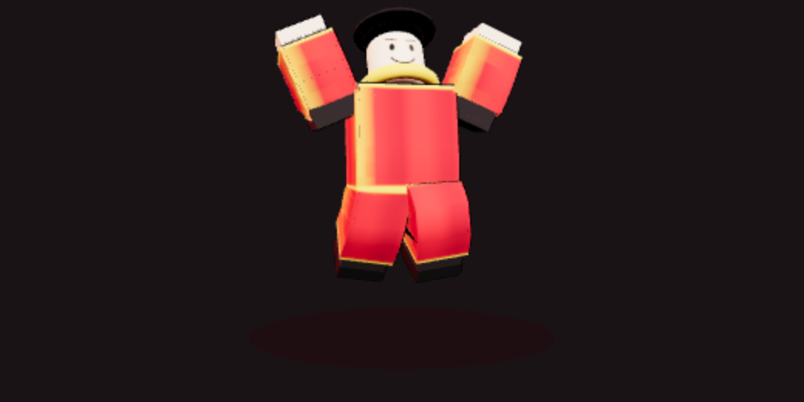
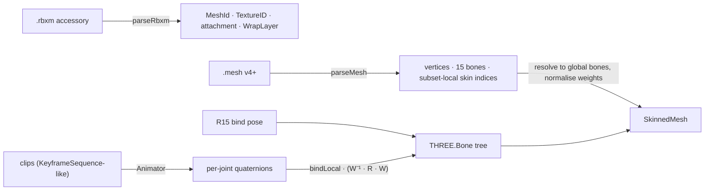

<div align="center">


# BlockRig

**Blocky R15 characters for three.js that wear real layered clothing and move like they do in-game.**

Read Roblox-format `.mesh` and `.rbxm` files, skin a jacket with its *own* bone weights, snap on hats and hair by attachment point, and play keyframe animations with priorities, weights, fades and Roblox-style easing. All in about 1,000 lines of dependency-free JavaScript.

[](https://github.com/dimasma0305/blockrig/actions/workflows/ci.yml)
[](https://www.npmjs.com/package/blockrig)
[](https://bundlephobia.com/package/blockrig)
[](https://threejs.org)
[](LICENSE)

[**Live demo**](https://dimasma0305.github.io/blockrig/) · [Quick start](#quick-start) · [API](#api) · [How it works](#how-it-works) · [Testing](#testing)

</div>

---

| | | | |
|:-:|:-:|:-:|:-:|
|  |  |  |  |
| `wave` | `run` | `card` | `victory` |

## Why

The 3D thumbnails you can export from Roblox are static OBJ files: no skeleton, no weights. Layered clothing like jackets and coats *does* ship with skin weights for all 15 R15 bones, but only inside the binary `.mesh` file, which no JavaScript library could read. BlockRig reads those weights and binds the garment to a three.js `SkinnedMesh`, so sleeves bend at the elbow and coat tails follow the legs, the way they do in-game.

## Features

- 🦴 **R15 skeleton** with Motor6D-style joints. Poses are written in the character's own axes (`{ RightUpperArm: [Math.PI, 0, 0] }` is "arm straight up"), whatever way each bone's local axes point.
- 🧥 **Layered clothing** as a real `SkinnedMesh` using the garment's own weights, with its bind pose retargeted onto your rig.
- 🎩 **Rigid accessories** placed by attachment matching (`Handle = Body · BodyAttachment · HandleAttachment⁻¹`).
- 🎞️ **Animator**: keyframe clips with `Linear / Constant / Cubic / Elastic / Bounce` × `In / Out / InOut`, priorities (`Idle → Action4`), weighted blending, linear fades, timed markers and root motion.
- 📦 **File readers**: `.mesh` **v2.00 → v7.00** (LODs, bones, subsets, skinning, FACS; v7 Draco via a hook) and binary **`.rbxm`** (LZ4 / ZSTD chunks, 12 property types).
- ✍️ **Mesh writer** (v2/v3/v4/v6) and a **procedural coat generator**, so you can build and test without any third-party assets.
- 🧪 **49 tests**, including golden regression snapshots, run on Node 20/22/24 × three.js r128/r184 in CI.
- 🪶 No runtime dependencies: `three` is the only peer dependency. ESM source, plus a UMD build for `<script>` tags. TypeScript types included.

## Quick start

```bash
npm install blockrig three
```

```js
import * as THREE from "three";
import { createRig, Animator, clips, makeCoat } from "blockrig";

const rig = createRig({ outline: 0.025 });          // blocky body, feet on y = 0, facing +Z
scene.add(rig.object);

rig.addLayeredClothing(makeCoat());                  // or a parsed .mesh, see below

const anim = new Animator(rig);
anim.play(clips.idle);                               // Idle priority, loops
anim.play(clips.wave, { fade: 0.3 });                // Action priority, overrides only the arm it keys

renderer.setAnimationLoop(() => {
  anim.update(clock.getDelta());
  renderer.render(scene, camera);
});
```

### Wear a real garment

```js
import { parseMesh, loadRobloxTexture } from "blockrig";

const bytes = await fetch("jacket.mesh").then((r) => r.arrayBuffer()); // a skinned .mesh v4+
const jacket = parseMesh(bytes);
console.log(jacket.version, jacket.bones.map((b) => b.name));          // "version 4.01", 15 R15 bones
rig.addLayeredClothing(jacket, { map: loadRobloxTexture("jacket.png") });
```

### Read an accessory file

```js
import { parseRbxm, describeAccessory } from "blockrig";
import zlib from "node:zlib"; // Node 22.15+; in browsers pass e.g. fzstd's decompress

const acc = describeAccessory(parseRbxm(bytes, { zstd: (b) => zlib.zstdDecompressSync(b) }));
// { name, meshId, textureId, attachment: { name: "HairAttachment", cframe }, layered: { order, cageMeshId, ... } | null }
rig.addAccessory(parseMesh(hairBytes), { attachment: acc.attachment, map: loadRobloxTexture("hair.png") });
```

### `<script>` tag

```html
<script src="https://cdnjs.cloudflare.com/ajax/libs/three.js/r128/three.min.js"></script>
<script src="https://cdn.jsdelivr.net/npm/blockrig/dist/blockrig.umd.min.js"></script>
<script>
  const rig = BlockRig.createRig();
  const anim = new BlockRig.Animator(rig);
</script>
```

## Write your own clips

Clips are plain JSON, shaped like a Roblox `KeyframeSequence`. A pose's `ease`/`dir` shape the move **from** its keyframe to the joint's next keyframe. A joint can be left out of any keyframe and will interpolate across the gap.

```js
const salute = {
  name: "salute", priority: "Action", loop: false, length: 1.2,
  markers: [{ t: 0.4, name: "snap" }],
  keyframes: [
    { t: 0,   poses: { RightUpperArm: { r: [0, 0, 0.1], ease: "Cubic", dir: "Out" } } },
    { t: 0.4, poses: { RightUpperArm: { r: [2.4, 0, 0.6] }, RightLowerArm: { r: [1.9, 0, 0], ease: "Elastic", dir: "Out" } } },
    { t: 1.2, poses: { RightUpperArm: { r: [0, 0, 0.1] }, RightLowerArm: { r: [0, 0, 0] } } },
  ],
};
anim.onMarker((name) => name === "snap" && playSound());
anim.play(salute, { fade: 0.15 });
```

**Axes cheat sheet** (character space, Y up, the character faces −Z):

| Joint | `+X` | `+Y` | `+Z` |
|---|---|---|---|
| arms / legs | swing forward (`π` = straight up) | twist | right arm out (left arm: `−Z`) |
| `LowerLeg` / `LowerArm` | `−X` bends the knee · `+X` bends the elbow | | |
| `UpperTorso` / `LowerTorso` | lean back (`−X` leans forward) | turn left | tilt |
| `Neck` | look up | look left | tilt |
| `HumanoidRootPart` | `{ p: [x, y, z] }` moves the whole body (studs) | | |

## API

| | |
|---|---|
| `createRig({ skeleton?, body?, face?, outline? })` | Builds the rig. `body: false` skips the blocky body; `face` is an image or canvas decal. |
| `rig.setPose(pose)` / `rig.resetPose()` | `{ Joint: [x, y, z], rootOffset: [x, y, z] }` in radians and studs. |
| `rig.setJoint(name, x, y, z)` · `setJointQuat(name, q)` · `nudgeJoint(name, x, y, z)` | Set one joint, or add on top of the current pose (good for look-at). |
| `rig.addLayeredClothing(mesh, { map?, color?, lod? })` | Skinned garment from `parseMesh` (v4+) or `makeCoat()`. |
| `rig.addAccessory(mesh, { attachment, map?, color? })` | Rigid accessory welded by attachment name (`HairAttachment`, `HatAttachment`, `FaceFrontAttachment`, `FaceCenterAttachment`). |
| `new Animator(rig)` | `.play(clip, { fade, weight, speed })` · `.stop(clipOrName, fade)` · `.update(dt)` · `.onMarker(fn)` · `.isPlaying(name)` |
| `parseMesh(bytes, { decodeDraco? })` | `.mesh` v2–v7 → `{ positions, normals, uvs, indices, lods, bones, skinIndex, skinWeight, subsets, facs }` |
| `writeMesh(mesh, "2.00" \| "3.00" \| "4.00" \| "6.00")` | Encode a mesh, including skinning. |
| `parseRbxm(bytes, { zstd? })` · `describeAccessory(roots)` · `findInstance` · `assetId` | Binary model files. |
| `cframeToMatrix` · `matrixToCFrame` · `motor6D` · `accessoryWeld` | CFrame maths. |
| `makeCoat({ length, slices, puff, tails })` | Procedural skinned coat (no external assets). |
| `clips` | `idle`, `wave`, `showtime`, `run`, `card`, `victory`: original keyframes. |

Full typings are in [`src/index.d.ts`](src/index.d.ts).

## How it works



- **Joints.** Roblox moves a joint with `Part1 = Part0 · C0 · Transform · C1⁻¹`. Clothing skeletons store each bone's *world* bind CFrame `W` instead, and limb bones are flipped 180° about X. To keep poses readable, a rotation `R` in character axes becomes the bone-local delta `W⁻¹ · R · W`, applied on top of the bind rotation.
- **Skinning.** Weights in a `.mesh` index into a *subset's* bone list, not the global one. BlockRig resolves them, normalises the bytes to floats, and builds the three.js `Skeleton` with bone inverses taken from the **garment's own** bind CFrames. A garment made on a slightly different body still sits correctly at rest and moves with your rig.
- **Blending.** Per joint, tracks at the same priority are weight-averaged with slerp. Each higher priority is laid over the result by its total weight (max 1), so an `Action` wave only overrides the arm it keys while `Idle` keeps breathing.

## Testing

```bash
npm test             # 49 unit + regression tests (node:test, no browser needed)
npm run test:update  # refresh golden snapshots after an intentional change, then review the diff
npm run screenshots  # re-render docs/*.png with a local Chrome/Edge
npm run demo         # http://127.0.0.1:8787/examples/
```

- **Unit tests** cover LZ4 vectors and corrupt input, every mesh version (round-trips through the writer, subset index resolution, FACS skipping, the Draco hook, truncation and bad indices), `.rbxm` raw/LZ4/ZSTD chunks and all property encodings, CFrame maths, joint axes, skinning at rest and in motion, retargeting, accessories, easing curves, interpolation, looping, priorities, weights, fades, markers and root motion.
- **Regression tests** pin the writer's output byte-for-byte (SHA-256), the parse of a committed fixture file, and the joint positions plus skinned coat vertices of every bundled clip at four points in time.
- **CI** runs everything on Node 20, 22 and 24 against three.js r128 and r184, builds the UMD bundle, smoke-tests it in a VM and checks the package contents. Pushing a `v*` tag publishes to npm with provenance and creates a GitHub release. `main` deploys the demo to GitHub Pages.

## Assets and trademarks

BlockRig contains **no Roblox assets**. Every screenshot and test uses a coat generated by `makeCoat()`, a face drawn on a canvas and original animations. If you load files downloaded from Roblox, make sure you have the right to use them: catalog items belong to their creators, and Roblox's Terms of Use apply. The `.mesh` reader follows the community-documented format ([spec](https://devforum.roblox.com/t/roblox-mesh-format/326114)) and the `.rbxm` reader follows [Rojo's binary format docs](https://dom.rojo.space/binary.html).

*Roblox is a trademark of Roblox Corporation. This project is not affiliated with, endorsed by or sponsored by Roblox Corporation.*

## License

[MIT](LICENSE) © dimasma0305
