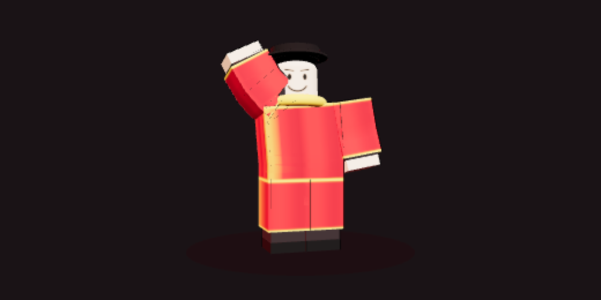
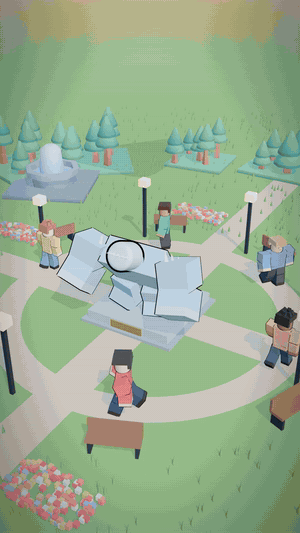
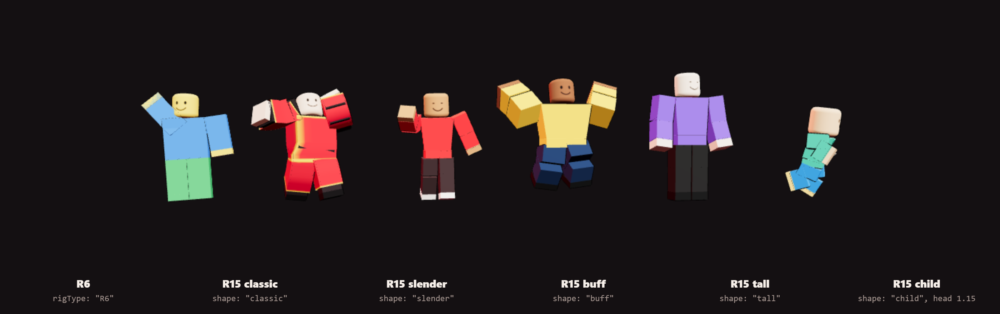
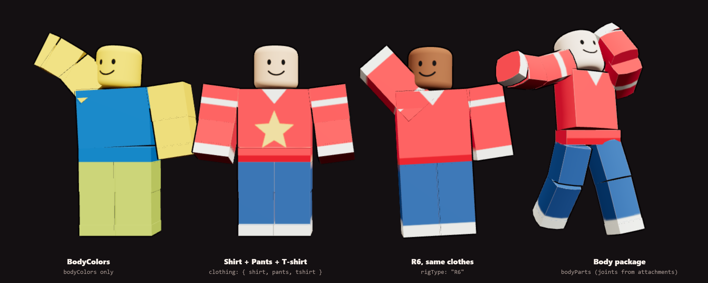
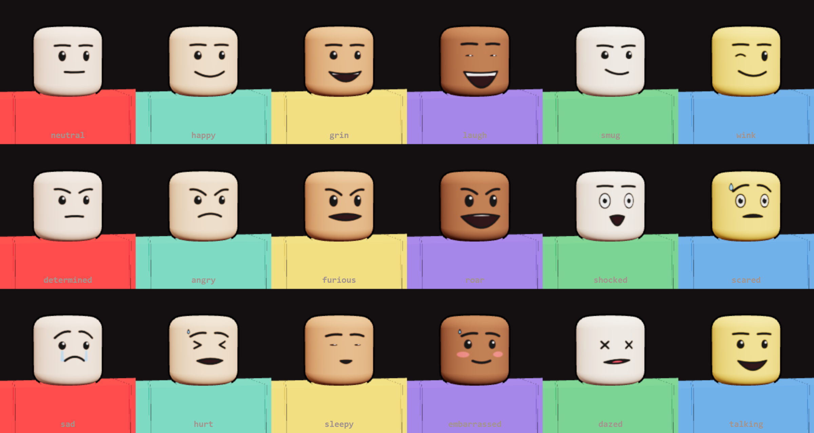
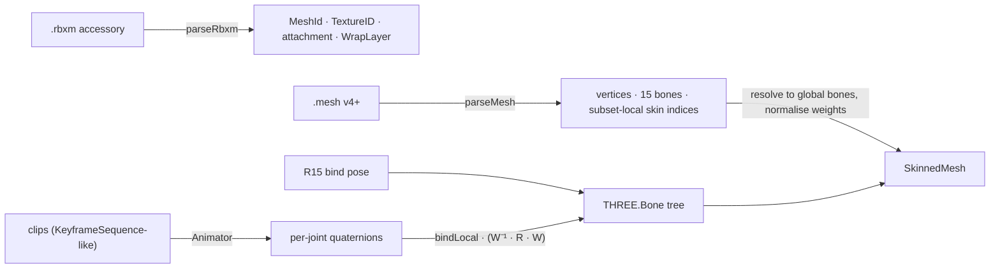

<div align="center">


# BlockRig

**Blocky R15 characters for three.js that wear real layered clothing and move like they do in-game.**

Read Roblox-format `.mesh` and `.rbxm` files, skin a jacket with its *own* bone weights, snap on hats and hair by attachment point, and play keyframe animations with priorities, weights, fades and Roblox-style easing. All in about 1,000 lines of dependency-free JavaScript.

[](https://github.com/dimasma0305/blockrig/actions/workflows/ci.yml)
[](https://www.npmjs.com/package/blockrig)
[](https://bundlephobia.com/package/blockrig)
[](https://threejs.org)
[](LICENSE)

[**Live demo**](https://dimasma0305.github.io/blockrig/) · [Quick start](#quick-start) · [API](#api) · [How it works](#how-it-works) · [Testing](#testing)

</div>

---

| | | | |
|:-:|:-:|:-:|:-:|
|  |  |  |  |
| `wave` | `run` | `card` | `victory` |

## Made with BlockRig: a story short

<table><tr>
<td width="300"><a href="docs/story.mp4"></a></td>
<td>

**"The Ice Statue"**: a 26-second vertical short in the viral *"In this town…"* format, made entirely in code. BlockRig plays the cast (a kid, a giant ice statue on the `buff` body, the townsfolk) with its Animator and drawn expressions. Remotion and three.js render it frame by frame over a CC0 town, with a narrated voice, an original score and word-timed captions.

▶ [**Watch it with sound**](docs/story.mp4) · [How it's made](examples/story/README.md)

</td>
</tr></table>

## Scope

BlockRig is a **character** library: rigs, bodies, heads, clothing, accessories, faces and animation for Roblox-style characters. It doesn't build worlds (Parts, Terrain, materials, Lighting, Sky) or handle physics, controllers or cameras. Put your character in any three.js scene you like. See [AGENTS.md](AGENTS.md#scope-characters-only).

## Why

The 3D thumbnails you can export from Roblox are static OBJ files: no skeleton, no weights. Layered clothing like jackets and coats *does* ship with skin weights for all 15 R15 bones, but only inside the binary `.mesh` file, which no JavaScript library could read. BlockRig reads those weights and binds the garment to a three.js `SkinnedMesh`, so sleeves bend at the elbow and coat tails follow the legs, the way they do in-game.

## Features

- 👕 **Roblox avatars**: `BodyColors`, classic **Shirt / Pants / T-shirt** templates composited the Roblox way, and **body packages** whose joints are built from their rig attachments (`BuildRigFromAttachments`), with accessories on body attachments too.
- 🧍 **Every classic body**: **R6** (six parts, classic pivots) and **R15** in five shapes (`classic`, `slender`, `buff`, `tall`, `child`) or your own proportions, with Roblox-style `height / width / depth / head` scaling, swappable body-part meshes, and R15 ⇄ R6 clip retargeting.
- 😃 **Live facial expressions**: 17 built-in expressions drawn from 21 blendable parameters (brows, eye shape, look direction, wink, `><` and `x` eyes, mouth curve/open/skew, teeth, tongue, blush, tears, sweat), with automatic blinking, talking, smooth fades and `face:` markers inside clips. Works on BlockRig heads or as a decal on any head.
- 🦴 **R15 skeleton** with Motor6D-style joints. Poses are written in the character's own axes (`{ RightUpperArm: [Math.PI, 0, 0] }` is "arm straight up"), whatever way each bone's local axes point.
- 🧥 **Layered clothing** as a real `SkinnedMesh` using the garment's own weights, with its bind pose retargeted onto your rig.
- 🎩 **Rigid accessories** placed by attachment matching (`Handle = Body · BodyAttachment · HandleAttachment⁻¹`).
- 🎞️ **Animator**: keyframe clips with `Linear / Constant / Cubic / Elastic / Bounce` × `In / Out / InOut`, priorities (`Idle → Action4`), weighted blending, linear fades, timed markers and root motion.
- 📦 **File readers**: `.mesh` **v1.00 → v7.00** (v1 text, LODs, bones, subsets, skinning, FACS; v7 Draco via a hook), binary **`.rbxm`** (LZ4 / ZSTD chunks) and XML **`.rbxmx`**, detected automatically.
- ✍️ **Mesh writer** (v2/v3/v4/v6) and a **procedural coat generator**, so you can build and test without any third-party assets.
- 📥 **Real Roblox animations**: import `KeyframeSequence` `.rbxm` files with full Pose CFrames, `Weight`, Roblox easing (including legacy Cubic's quirk), Loop, Priority, named keyframes and markers, for R15 and R6.
- 🧪 **97 tests**, including golden regression snapshots, run on Node 20/22/24 × three.js r128/r184 in CI.
- 🪶 No runtime dependencies: `three` is the only peer dependency. ESM source, plus a UMD build for `<script>` tags. TypeScript types included.

## Quick start

```bash
npm install blockrig three
```

```js
import * as THREE from "three";
import { createRig, Animator, clips, makeCoat } from "blockrig";

const rig = createRig({ outline: 0.025 });          // blocky body, feet on y = 0, facing +Z
scene.add(rig.object);

rig.addLayeredClothing(makeCoat());                  // or a parsed .mesh, see below

const anim = new Animator(rig);
anim.play(clips.idle);                               // Idle priority, loops
anim.play(clips.wave, { fade: 0.3 });                // Action priority, overrides only the arm it keys

renderer.setAnimationLoop(() => {
  anim.update(clock.getDelta());
  renderer.render(scene, camera);
});
```

### Wear a real garment

```js
import { parseMesh, loadRobloxTexture } from "blockrig";

const bytes = await fetch("jacket.mesh").then((r) => r.arrayBuffer()); // a skinned .mesh v4+
const jacket = parseMesh(bytes);
console.log(jacket.version, jacket.bones.map((b) => b.name));          // "version 4.01", 15 R15 bones
rig.addLayeredClothing(jacket, { map: loadRobloxTexture("jacket.png") });
```

### Read an accessory file

```js
import { parseRbxm, describeAccessory } from "blockrig";
import zlib from "node:zlib"; // Node 22.15+; in browsers pass e.g. fzstd's decompress

const acc = describeAccessory(parseRbxm(bytes, { zstd: (b) => zlib.zstdDecompressSync(b) }));
// { name, meshId, textureId, attachment: { name: "HairAttachment", cframe }, layered: { order, cageMeshId, ... } | null }
rig.addAccessory(parseMesh(hairBytes), { attachment: acc.attachment, map: loadRobloxTexture("hair.png") });
```

### Roblox head shapes

Head catalog items are a `SpecialMesh` plus the head's own attachment points. `describeHead` reads both, and `setHead` puts the mesh on the neck by its `NeckRigAttachment`. Hair and hats added afterwards weld to that head's own `HairAttachment` / `HatAttachment`.

```js
import { parseRbxm, describeHead, parseMesh } from "blockrig";

const head = describeHead(parseRbxm(headModelBytes));        // { meshId, scale, offset, attachments }
rig.setHead(parseMesh(await fetchMesh(head.meshId)), head);  // fetchMesh: however you obtain the mesh file
rig.addAccessory(hairMesh, { attachment: hair.attachment }); // lands on the new head's HairAttachment
```

### `<script>` tag

```html
<script src="https://cdnjs.cloudflare.com/ajax/libs/three.js/r128/three.min.js"></script>
<script src="https://cdn.jsdelivr.net/npm/blockrig/dist/blockrig.umd.min.js"></script>
<script>
  const rig = BlockRig.createRig();
  const anim = new BlockRig.Animator(rig);
</script>
```

## Body types



```js
createRig({ rigType: "R6" });                                    // Torso, Left Arm, Right Arm, Left Leg, Right Leg + Neck
createRig({ shape: "slender" });                                 // classic | slender | buff | tall | child
createRig({ shape: { top: 2.4, arm: 1.2, limbs: 1.1 } });        // your own proportions
createRig({ scale: { height: 1.2, width: 0.9, depth: 1, head: 1.3 } }); // Roblox-style body scales
```

| Option | What it changes |
|---|---|
| `rigType: "R6"` | Six-part classic rig. Shoulders pivot at the top inner edge of each arm and hips at the top **outer** corner of each leg, as on the classic rig. Joints are `Torso`, `Left Arm`, `Right Arm`, `Left Leg`, `Right Leg`, `Neck` (`Head` is an alias). |
| `shape` | R15 proportions: torso width at the shoulders (`top`) and waist, `depth`, `arm` and `leg` thickness, `legX` spacing, `limbs` and `torso` length. `classic` reproduces the standard blocky R15 skeleton exactly. |
| `scale` | `height`, `width` and `depth` stretch the skeleton and parts about the feet; `head` grows the head and everything attached to it. |
| `rig.setBodyPart(name, mesh, o)` | Replace one blocky part with your own mesh (given in the part's local space, as MeshPart meshes are), e.g. a body-bundle arm or a custom head. |

R15 and R6 animations aren't interchangeable, because poses are matched by part name. BlockRig can retarget between them:

```js
import { toR6, toR15, retargetAll, clips } from "blockrig";
new Animator(createRig({ rigType: "R6" })).play(toR6(clips.run)); // upper limbs + torso + neck + root motion
const r6Clips = retargetAll(clips, toR6);
```

Layered clothing needs an R15 rig (garments are skinned to the 15 R15 bones). It follows every R15 shape, staying attached to its bones as they move apart.

## Roblox avatars: body packages, BodyColors and clothing



Dress a rig the way Roblox does. Any of these options switches the body to Roblox's avatar mode:

```js
import { createRig, parseRbxm, parseMesh, describeBodyParts, describeBodyColors, describeClothing } from "blockrig";

const rig = createRig({
  bodyColors: { HeadColor3: "#f5cd30", TorsoColor3: "#0d69ac", LeftLegColor3: "#a4bd47", RightLegColor3: "#a4bd47" },
  clothing: { shirt: shirtImage, pants: pantsImage, tshirt: logoImage }, // loaded images or textures
});
rig.setClothing({ shirt: otherShirt, tshirt: null });   // swap or take off
rig.setBodyColors({ TorsoColor3: "#ffffff" });
```

| Roblox | BlockRig |
|---|---|
| `BodyColors` (six `*Color3` regions) | `bodyColors`, `rig.setBodyColors()`, `describeBodyColors(roots)` |
| `Shirt.ShirtTemplate`, `Pants.PantsTemplate`, `ShirtGraphic.Graphic` | `clothing: { shirt, pants, tshirt }`, `rig.setClothing()`, `describeClothing(roots)` |
| Body package MeshParts (`R15ArtistIntent` / `R15Fixed`) | `describeBodyParts(roots)` + `createRig({ bodyParts })` |
| `Humanoid:BuildRigFromAttachments()` | `buildBodyFromParts()`: every joint sits where the parent's and child's `<Joint>RigAttachment` meet |
| Body attachments (`BodyBackAttachment`, `RightGripAttachment`, …) | `rig.addAccessory()` welds to them too; `rig.bodyAttachments` |

Clothing is composited per body region like Roblox does it: the body colour first, then Pants, then Shirt (the shirt covers the pants on the torso), then the T-shirt on the torso front. The images use the classic **585×559** template (`TEMPLATE` gives every face's rectangle). On blocky R15 parts each limb's rectangle is split between its parts by height, so classic clothes line up across shoulder, elbow and wrist.

A body package brings its own proportions. Pass each part's mesh, `Size` and attachments, and the joints move with them:

```js
const parts = describeBodyParts([...parseRbxm(leftArmFile), ...parseRbxm(torsoFile)]); // { LeftUpperArm: { meshId, size, attachments }, ... }
const bodyParts = {};
for (const [name, p] of Object.entries(parts)) bodyParts[name] = { ...p, mesh: parseMesh(await fetchMesh(p.meshId)) }; // fetchMesh: your own loader for the asset bytes
const rig = createRig({ bodyParts, bodyColors, clothing });  // parts you leave out stay blocky
```

Meshes are fitted to their part's `Size`, as MeshParts are. R15 body meshes are UV-mapped to Roblox's per-limb composite textures, whose layout isn't published, so BlockRig projects the classic clothing onto each mesh from its shape, the same way it maps onto the blocky parts. Tested on the official ROBLOX Boy and Woman packages with Roblox-made shirts and pants. Pass `uvs: "mesh"` on a part to keep the mesh's own UVs (for example with its own `map`). The example page [`examples/clothing.html`](examples/clothing.html) draws its shirt, pants and T-shirt in code, so it needs no downloads.

## Expressions



```js
import { createRig, createFace, Animator } from "blockrig";

const face = createFace({ expression: "determined" });   // blinks on its own
const rig = createRig({ face });                          // wrapped onto the block head, updated by the Animator

rig.setExpression("furious", { fade: 0.15 });            // blend to another expression
rig.setExpression({ mouthOpen: 0.8, browY: 0.6 });       // or set any parameters directly
face.lookAt(0.6, -0.2);                                  // eyes follow a target
face.talk(true);                                         // mouth flaps until talk(false)

// switch faces from inside a clip
const taunt = { name: "taunt", length: 1.2, keyframes: [/* ... */],
  markers: [{ t: 0.1, name: "face:smug" }, { t: 0.8, name: "face:laugh" }] };
```

### Face decals, the Roblox way

Classic Roblox faces are a `Decal` named `face` on the `Head`. Changing the expression means replacing its `Texture`, and the change is instant. BlockRig does the same with images you supply:

```js
const face = createFace({ images: { calm: calmImg, angry: angryImg, hurt: hurtImg, blink: blinkImg }, expression: "calm" });
const rig = createRig({ face });        // or rig.addFaceDecal(face) on a downloaded avatar's head
rig.setExpression("angry");             // instant swap, like setting Decal.Texture
rig.setExpression("hurt", { fade: 0.2 }); // optional crossfade (BlockRig extra)
```

Image names can be anything. A name with no image falls back to the procedural face, and `images.blink` (optional) shows while the face blinks. BlockRig ships no Roblox decals; use images you have the right to use.

### Procedural expressions (BlockRig extra)

Each expression is a set of numbers, so any two blend smoothly. You can mix your own with `mixFace(a, b, t)`, or draw a single frame onto any 2D canvas with `drawFace(ctx, params, style)`. For heads that aren't BlockRig's barrel, such as downloaded avatars, `rig.addFaceDecal(face, { radius, height, arc })` puts the live face on a curved decal that follows the neck. Style options are `ink`, `eyeColor`, `glow` (glowing monster eyes) and `background` (an opaque decal that covers a baked-in face).

| Parameter | Range | | Parameter | Range |
|---|---|---|---|---|
| `browAngle` | −1 worried → 1 angry | | `mouthCurve` | −1 frown → 1 smile |
| `browY` | −1 low → 1 raised | | `mouthOpen` | 0 → 1 |
| `eyeOpen`, `squint`, `eyeSize` | blink, smiling eyes, size | | `mouthWidth`, `mouthSkew` | width, smirk |
| `whites` | 0 ink → 1 white with pupil | | `teeth`, `tongue` | 0 → 1 |
| `lookX`, `lookY` | −1 → 1 | | `blush`, `tears`, `sweat` | 0 → 1 |
| `wink`, `wince`, `ko` | right-eye wink, `><`, `x` | | `brows` | 0 hidden → 1 |

## Import Roblox animations

Animations made in Roblox Studio or downloaded from Roblox are `KeyframeSequence` models. Read them with `parseRbxm` and convert:

```js
import { parseRbxm, keyframeSequenceToClip, Animator } from "blockrig";

const bytes = await fetch("my-wave.rbxm").then((r) => r.arrayBuffer());
const clip = keyframeSequenceToClip(parseRbxm(bytes, { zstd }), { name: "wave" }); // rigType: "R6" for R6 animations
new Animator(rig).play(clip, { fade: 0.1 });
```

- Each `Pose` drives the joint whose part has its name. Its `CFrame` becomes the Motor6D `Transform` (rotation and translation), and `Weight` is honoured.
- `EasingStyle` / `EasingDirection` (including legacy Cubic's reversed direction and `CubicV2`), `Loop` and `Priority` come across as they are.
- Named keyframes and `KeyframeMarker`s arrive through `animator.onMarker((name, clip) => …)`, like `KeyframeReached` / `GetMarkerReachedSignal`.
- R6 animations are converted out of the classic R6 joint frames, so they play correctly on `rigType: "R6"` rigs.
- Joints your rig doesn't have (Rthro extras, face bones) are skipped.
- XML `.rbxmx` files work the same way (`parseRbxm` detects them). Not supported yet: `CurveAnimation`.

BlockRig ships no Roblox animations. Use animations you made or have the right to use.

## Write your own clips

Clips are plain JSON, shaped like a Roblox `KeyframeSequence`. A pose's `ease`/`dir` shape the move **from** its keyframe to the joint's next keyframe. A joint can be left out of any keyframe and will interpolate across the gap.

```js
const salute = {
  name: "salute", priority: "Action", loop: false, length: 1.2,
  markers: [{ t: 0.4, name: "snap" }],
  keyframes: [
    { t: 0,   poses: { RightUpperArm: { r: [0, 0, 0.1], ease: "Cubic", dir: "Out" } } },
    { t: 0.4, poses: { RightUpperArm: { r: [2.4, 0, 0.6] }, RightLowerArm: { r: [1.9, 0, 0], ease: "Elastic", dir: "Out" } } },
    { t: 1.2, poses: { RightUpperArm: { r: [0, 0, 0.1] }, RightLowerArm: { r: [0, 0, 0] } } },
  ],
};
anim.onMarker((name) => name === "snap" && playSound());
anim.play(salute, { fade: 0.15 });
```

**Axes cheat sheet** (character space, Y up, the character faces −Z):

| Joint | `+X` | `+Y` | `+Z` |
|---|---|---|---|
| arms / legs | swing forward (`π` = straight up) | twist | right arm out (left arm: `−Z`) |
| `LowerLeg` / `LowerArm` | `−X` bends the knee · `+X` bends the elbow | | |
| `UpperTorso` / `LowerTorso` | lean back (`−X` leans forward) | turn left | tilt |
| `Neck` | look up | look left | tilt |
| `HumanoidRootPart` | `{ p: [x, y, z] }` moves the whole body (studs) | | |

## API

| | |
|---|---|
| `createRig({ rigType?, shape?, scale?, skeleton?, body?, face?, outline? })` | Builds the rig. `body: false` skips the blocky body; `face` is an image or canvas decal. |
| `buildBody({ rigType, shape, scale })` · `R15_SHAPES` | The bind skeleton and part layout a rig is built from. |
| `rig.setBodyPart(name, mesh, { map?, color?, scale? })` | Swap a blocky part (or `"Head"`) for a mesh. |
| `describeHead(roots)` · `rig.setHead(mesh, { scale, offset, attachments })` · `rig.headAttachments` · `rig.headBounds()` | Roblox head assets: placed by `NeckRigAttachment`, with their own accessory attachments. |
| `keyframeSequenceToClip(roots, { name, rigType, cubicLegacy })` | Roblox `KeyframeSequence` → clip (Pose CFrame → Transform, Weight, easing, markers). |
| `rig.setJointOffset(name, x, y, z)` | Translation part of a joint's Transform. |
| `toR6(clip)` · `toR15(clip)` · `retargetAll(clips, fn)` | Retarget clips between rig types. |
| `createFace({ expression, images, ink, eyeColor, glow, background, blink })` | A live face: `.set(name or params, { fade })`, `.lookAt(x, y)`, `.talk(on)`, `.update(dt)`, `.onChange(fn)` |
| `rig.setExpression(...)` · `rig.addFaceDecal(face, o)` · `rig.face` | Drive the rig's face; markers named `face:<expression>` do it from a clip. |
| `EXPRESSIONS` · `FACE_DEFAULTS` · `expression()` · `mixFace()` · `drawFace()` · `createFaceDecal()` | Expression data and drawing. |
| `rig.setPose(pose)` / `rig.resetPose()` | `{ Joint: [x, y, z], rootOffset: [x, y, z] }` in radians and studs. |
| `rig.setJoint(name, x, y, z)` · `setJointQuat(name, q)` · `nudgeJoint(name, x, y, z)` | Set one joint, or add on top of the current pose (good for look-at). |
| `rig.addLayeredClothing(mesh, { map?, color?, lod? })` | Skinned garment from `parseMesh` (v4+) or `makeCoat()`. |
| `rig.addAccessory(mesh, { attachment, map?, color? })` | Rigid accessory welded by attachment name (`HairAttachment`, `HatAttachment`, `FaceFrontAttachment`, `FaceCenterAttachment`). |
| `new Animator(rig)` | `.play(clip, { fade, weight, speed })` · `.stop(clipOrName, fade)` · `.update(dt)` · `.onMarker(fn)` · `.isPlaying(name)` |
| `parseMesh(bytes, { decodeDraco? })` | `.mesh` v1–v7 → `{ positions, normals, uvs, indices, lods, bones, skinIndex, skinWeight, subsets, facs }` |
| `writeMesh(mesh, "2.00" \| "3.00" \| "4.00" \| "6.00")` | Encode a mesh, including skinning. |
| `parseRbxm(bytes or text, { zstd? })` · `parseRbxmx(text)` · `describeAccessory(roots)` · `findInstance` · `assetId` | Binary and XML model files. |
| `cframeToMatrix` · `matrixToCFrame` · `motor6D` · `accessoryWeld` | CFrame maths. |
| `makeCoat({ length, slices, puff, tails })` | Procedural skinned coat (no external assets). |
| `clips` | `idle`, `wave`, `showtime`, `run`, `card`, `victory`: original keyframes. |

Full typings are in [`src/index.d.ts`](src/index.d.ts).

## How it works



- **Joints.** Roblox moves a joint with `Part1 = Part0 · C0 · Transform · C1⁻¹`. Clothing skeletons store each bone's *world* bind CFrame `W` instead, and limb bones are flipped 180° about X. To keep poses readable, a rotation `R` in character axes becomes the bone-local delta `W⁻¹ · R · W`, applied on top of the bind rotation.
- **Skinning.** Weights in a `.mesh` index into a *subset's* bone list, not the global one. BlockRig resolves them, normalises the bytes to floats, and builds the three.js `Skeleton` with bone inverses taken from the **garment's own** bind CFrames. A garment made on a slightly different body still sits correctly at rest and moves with your rig.
- **Blending.** Per joint, tracks at the same priority are weight-averaged with slerp. Each higher priority is laid over the result by its total weight (max 1), so an `Action` wave only overrides the arm it keys while `Idle` keeps breathing.

## Testing

```bash
npm test             # 85 unit + regression tests (node:test, no browser needed)
npm run test:update  # refresh golden snapshots after an intentional change, then review the diff
npm run screenshots  # re-render docs/*.png with a local Chrome/Edge
npm run demo         # http://127.0.0.1:8787/examples/ (also bodies.html, faces.html and clothing.html)
```

- **Unit tests** cover LZ4 vectors and corrupt input, every mesh version (round-trips through the writer, subset index resolution, FACS skipping, the Draco hook, truncation and bad indices), `.rbxm` raw/LZ4/ZSTD chunks and all property encodings, CFrame maths, joint axes, every expression (valid parameters, the right shapes for open mouths, `x` and `><` eyes), face blending, blinking, look/talk, face markers and decals, every body shape and scale (feet on the floor, symmetry, parts on their joints), R6 pivots, retargeting, body-part swaps, skinning at rest and in motion, retargeting, accessories, easing curves, interpolation, looping, priorities, weights, fades, markers and root motion.
- **Regression tests** pin the writer's output byte-for-byte (SHA-256), the parse of a committed fixture file, the joint positions plus skinned coat vertices of every bundled clip at four points in time, the joint layout of every body shape, a scaled body, R6 and an R6-retargeted clip, and the exact drawing commands for every expression.
- **CI** runs everything on Node 20, 22 and 24 against three.js r128 and r184, builds the UMD bundle, smoke-tests it in a VM and checks the package contents. Pushing a `v*` tag publishes to npm with provenance and creates a GitHub release. `main` deploys the demo to GitHub Pages.

## Roblox parity

BlockRig follows Roblox's own mechanisms wherever they exist: Motor6D joints, attachment welds, KeyframeSequence-style clips with Roblox easing, AnimationTrack priorities and fades, R6/R15 part names, and face Decals. Anything Roblox doesn't have is opt-in and labelled as a BlockRig extra. [AGENTS.md](AGENTS.md) holds the full mechanism map, the known differences still being closed, and the rules for contributors and coding agents.

## Assets and trademarks

BlockRig contains **no Roblox assets**. Every screenshot and test uses a coat generated by `makeCoat()`, a face drawn on a canvas and original animations. If you load files downloaded from Roblox, make sure you have the right to use them: catalog items belong to their creators, and Roblox's Terms of Use apply. The `.mesh` reader follows the community-documented format ([spec](https://devforum.roblox.com/t/roblox-mesh-format/326114)) and the `.rbxm` reader follows [Rojo's binary format docs](https://dom.rojo.space/binary.html).

*Roblox is a trademark of Roblox Corporation. This project is not affiliated with, endorsed by or sponsored by Roblox Corporation.*

## License

[MIT](LICENSE) © dimasma0305
