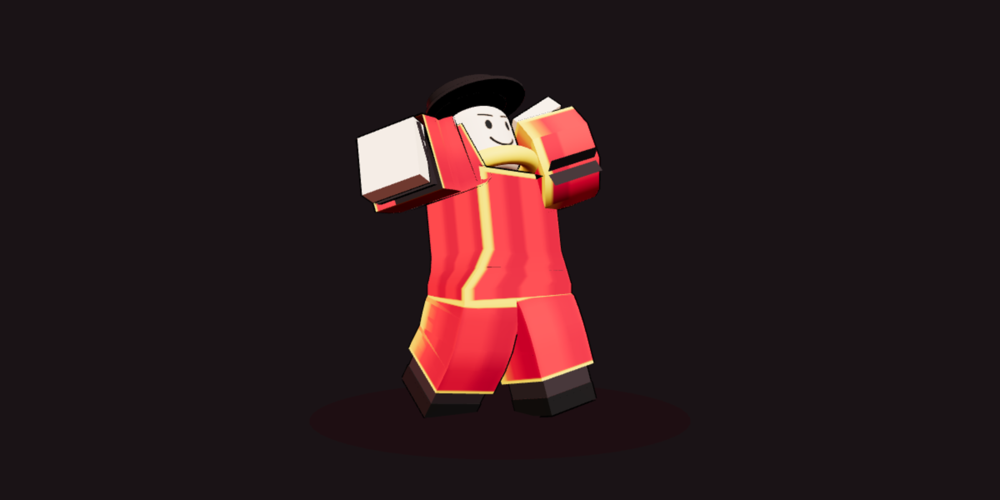
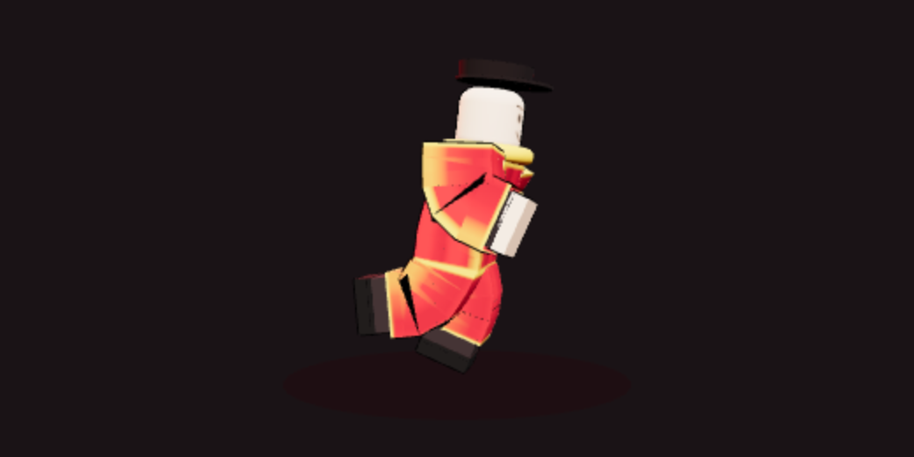
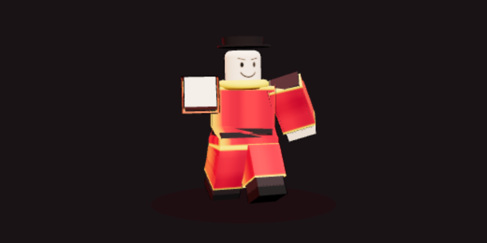
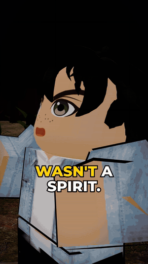
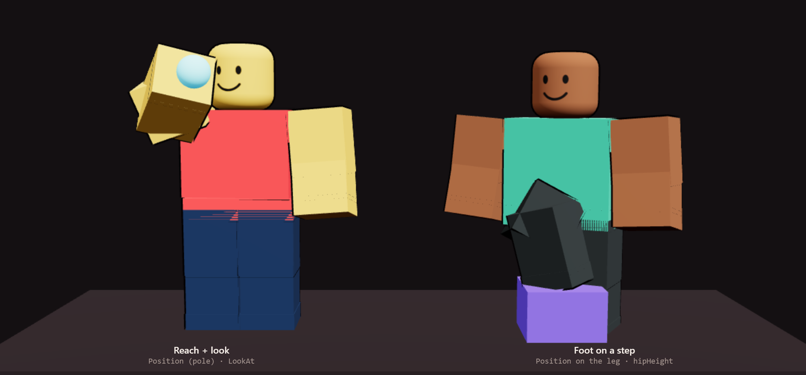
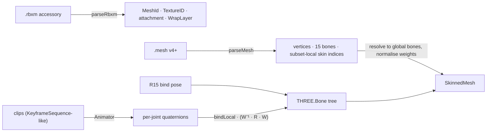

<div align="center">



# BlockRig

**Make Roblox-style story videos fast, and make them good.**

BlockRig is the engine behind narrated vertical Roblox-style shorts (YouTube Shorts, TikTok), made in code with three.js and Remotion. It gives you R6/R15 characters that wear real Roblox catalog items and play Roblox animations the way Roblox does. It also gives you the rest of a video: Roblox Toolbox maps, a staging check that catches cameras in walls and characters floating over beds, shots and captions timed to the voice, camera recipes, lighting looks and drawn screens. A video template ties it all together, from story to MP4.

[](https://github.com/dimasma0305/blockrig/actions/workflows/ci.yml)
[](https://www.npmjs.com/package/blockrig)
[](https://threejs.org)
[](LICENSE)

[**Live demo**](https://dimasma0305.github.io/blockrig/) · [Make a video](#make-a-video) · [Module map](#module-map) · [Examples](#made-with-blockrig) · [Characters](#characters) · [API](#api)

</div>

---

| | | | |
|:-:|:-:|:-:|:-:|
|  |  |  |  |
| `wave` | `run` | `card` | `victory` |

## Make a video

Every video starts as a copy of [`examples/template`](examples/template/README.md). The template holds the story documents, the scripts, an agent skill for each stage, and a small kit on top of BlockRig. A coding agent can run the whole pipeline: [`AGENTS.md`](examples/template/AGENTS.md) in the template is the source of truth for it.

```sh
cd examples/template
npm run new -- ../my-video "My Video"     # 1. a new video from the template
cd ../my-video && npm install
```

1. **Story.** Write `docs/story.md`: the hook in the first 2 seconds, the twist, and a shot list with one line per shot. Each shot can set its camera, `speaker:` for dialogue (caption tags and per-character voices), `note:` for an on-screen explainer, and a lighting preset. `docs/visuals.md` lists the cast and places; `docs/audio.md` the voices and music.
2. **Voice.** `npm run voice` makes every line offline in plain Node (chatterbox-js, no Python), with one voice per character. Speech recognition checks each take, and the measured word timings set every shot's length and caption. `npm run check` confirms the voice says the right words at the right pace.
3. **Assets.** `npm run assets` gets CC0 models, skies and textures. `npm run roblox` gets Roblox catalog items (hair, outfits, faces) and Toolbox maps through your signed-in browser. `npm run pack -- bundle:356 rthro` gets a whole Roblox pack by its id (see [Roblox packs](#roblox-packs-by-id)). Real creator images go in `assets/brands/`. All of these stay out of git.
4. **Stills.** `npm run stills` (or `npm run stills -- s01`) renders one frame per shot to `out/stills/` and a contact sheet, so you can review the look before a long render.
5. **Collide.** `npm run collide` runs the Rapier staging check on the real frames. It finds cameras inside walls, faces hidden behind props, characters inside furniture, and characters floating, sunk or stiff on a soft bed.
6. **Render.** `npm run render` renders `out/<slug>.mp4` (1080×1920, with the voice, music and captions). `npm run fast-gpu` (once, on laptops with two GPUs) makes renders about 4× faster.

**Renders are cached:** the bundle, each shot's video segment and the soundtrack are kept, so a re-render redoes only what changed: 3 s with no change, about 40 s for one changed shot (`npm run render -- --only s03`), against 168 s before.

**Or all at once:** `npm run make` runs docs → voice (if there is none yet) → check → stills → collide, and writes `out/report.html`. The report shows what passed, each problem with its shot and frames, what needs you (a sign-in, a missing pack), the pace and pitch, the contact sheet and every shot's still. `npm run make -- --render` renders too when nothing is wrong. Re-voicing only redoes lines whose text, voice or mood changed.

## Module map

Six entry points, all ESM with TypeScript types. `three` is the only required peer dependency; the Remotion parts use the video's own React, Remotion and post-processing:

| Import | What it's for |
|---|---|
| `blockrig` | **Characters**: R15/R6 rigs and bodies, Roblox `.mesh` / `.rbxm` / `.rbxmx` readers, layered clothing, accessories, welds and tools, faces (decals, FACS, drawn expressions), the Animator, IK. Follows Roblox's own mechanisms ([AGENTS.md](AGENTS.md)). |
| `blockrig/video` | **The rest of the video**: everything a story short needs besides its characters, framework-free and frame-pure (a frame depends only on its time, so Remotion can render frames in any order and in parallel). |
| `blockrig/pack` | **Whole Roblox packs by id**: a bundle (body package, dynamic head, animation pack, outfit), a player's whole avatar (`user:<name>`), an outfit, or a single asset (accessory, shirt, emote, Toolbox model), referenced as `bundle:356`, `user:Roblox` or `asset:376548738`, downloaded once into a cache every video shares, and turned into rig parts, accessories, clothing, clips by slot, or a map. `blockrig/pack/cache` is the disk cache (Node). |
| `blockrig/remotion` | **The 2D layers over the 3D canvas**: word-synced captions with speaker tags, the soundtrack, vignette, scanlines, glitch and flash cuts, a screen flash, the debug overlay with the app zones. `blockrig/remotion/post` adds the post effects (N8AO ambient occlusion, bloom, SMAA, ACES) with their fixes (no black frames). |
| `blockrig/voice` | **The narration**: what each line is voiced as, whether a take is good, where the pauses go, and whether the whole thing is paced right. Pure JavaScript with no dependencies; the video runs the speech models (Chatterbox, Kokoro, Whisper) and ffmpeg. |

What's in `blockrig/video`:

| Module | Exports | What it does |
|---|---|---|
| timeline | `createTimeline`, `speakersOf` | Shots, captions and music from the story and the measured voice. Shot lengths come from the voice; each caption pops in on its first spoken word and carries its shot's `speaker`. |
| motion | `rng`, `easeInOut`, `easeOut`, `smooth`, `lerp`, `clamp01` | Seeded randomness and easing that look the same in every render tab. |
| pose | `poseAt`, `groundRig`, `FEET`, `KNEEL`, `SEAT`, `ON_SEAT` | Frame-pure posing with the Animator (seek each track; Roblox priorities and blending), and feet or hips placed on a surface. |
| camera | `pushIn`, `orbit`, `move`, `follow`, `lowAngle`, `topDown`, `applyCamera` | Camera recipes for shorts; shake is seeded by frame. |
| frame | `frame`, `screenOf`, `ZONES`, `captionBand` | Framing by where faces should land: give the faces and the side to shoot from, and the camera's distance and height put every face at the chosen height, inside the margins (clear of the app buttons, shoulders included) and out of the caption band. |
| place | `surfaces`, `placeOn` | Characters rest on whatever is under them by raycast (Roblox map part boxes, meshes): feet on the floor, hips sunk into a soft bed. No hand-measured heights. |
| lighting | `createLighting`, `TIMES`, `daylight`, `mixDaylight`, `LOOK`, `applyLook`, `avatarAmbient` | Sky dome, sun with soft shadows, fill and lightning; times of day (day, golden, dusk, night, storm) that blend across a shot. |
| surfaces | `surfaceOf`, `restOn` | How far a body sinks into a bed, sofa, pillow, grass or floor, from the part's name or its Roblox `Material`. |
| robloxMap | `buildRobloxMap`, `partGeometry`, `facePlane`, `materialLook`, `swallowingUnions`, `trimUnion` | Draws a Roblox map or model from its part list: Part shapes, wedges, mesh modifiers, MeshParts, Decals and Textures on `NormalId` faces, lights. Parts are merged per material. Also exports one solid collider box per visible part. Desk and table tops that are unions (drawn as one box) are trimmed so they don't cover the chair standing in them. |
| collide | `createProbe`, `loadRapier` | The staging check: Rapier colliders for the world (rebuilt per shot from what's visible), then `check(camera, cast, { captions })` lists `camera-inside`, `hidden`, `inside`, `floating`, `sunk`, `stiff`, `overlap` and `caption-over-face`. A seated character never counts as inside its own chair. You install Rapier (`@dimforge/rapier3d-compat`) and pass it in. |
| boards | `panel`, `text`, `pic`, `videoCard`, `browserWindow`, `banner`, `poster`, `standee` | Drawn screens, signs, posters and cardboard cut-outs. A panel redraws only when what it shows changes, and real images are cover-fitted (a grey box when one is missing). |
| images | `loadImages`, `loadImage` | Loads named real images (avatars, thumbnails, logos) before the first frame; a missing file becomes `null`. |
| plan | `Plan`, `rect`, `circle`, `polygon`, `inside`, `intersects` | The 2D layout of a place before it becomes 3D: keep-out zones (roads, paths, the stage), lots, footprints that may not overlap, `scatter` and `along` for trees, fences and lamps, and `conflicts()`. |
| ground | `layer`, `groundConflicts`, `checkGround` | Flat ground surfaces on their own layer (height step plus polygon offset), so grass, roads and puddles never flicker. |
| lights | `lightsByLocation` | Each place's lamps are on only while the camera is there: every light costs every pixel, so this keeps renders fast. |
| story | `compileStory`, `parseStory`, `parseAudio`, `checkStory` | `docs/story.md` and `docs/audio.md` compiled into the story object. Broken shots are caught before any voice or render time: captions that don't cover the line, `say:` that changes the word count, silent shots without a length, and unknown faces, weather, times, emotions, lighting presets or music. |

What's in `blockrig/voice`:

| Module | Exports | What it does |
|---|---|---|
| text | `spellNumbers`, `normalizeWords`, `matchScore` | Did the take say the line? Letter-level matching, with numbers spelled the way they're spoken ("$5,000" = "five thousand dollars") and homophones counted as right. |
| takes | `EMOTIONS`, `moodOf`, `emotionSettings`, `voiceOf`, `judgeTake`, `maxTakeSeconds`, `alignWords`, `estimateWords` | One narrator for every mood (emotion is performance strength, tempo within 5% and loudness, never pitch). Dialogue lines use their speaker's own voice. Takes are judged words first, then pitch, then length (runaway takes are capped). Caption word times come from speech recognition only when they make sense. |
| audio | `medianPitch`, `speechBounds`, `trimToSpeech`, `addPauses`, `pauseAfter`, `encodeWav` | YIN pitch, clips trimmed to their speech, and real silence at commas (0.22 s) and stops (0.4 s), cut only into silence so a word is never split. |
| checks | `pace`, `pitchReport`, `wordTimeProblems`, `musicSections` | Pace over the spoken shots (~160 wpm; over 190 is rushed), each voice against its own median pitch, caption times, and music sections (`none` is silence). |

**What stays in each video** (the template's `src/kit`, `src/cast`, `src/world`, `src/direction`):

- **Anything that needs React, Remotion, post-processing or drei**: `Captions` and `Soundtrack` components, overlays, `usePost` (N8AO ambient occlusion and bloom), `LightRig` presets, cascaded shadows, asset loading hooks.
- **The template's own look, which each video changes**: code-built houses and streets, weather, procedural textures, fire.
- **Running the models**: the voice scripts call Chatterbox, Kokoro, Whisper and ffmpeg, and the music generator writes its own themes.
- **The story itself**: cast, wardrobe, world, shot direction, story props and boards.

When a fix in a video would help every video, move it into `blockrig/video` with a test. The rule is in [AGENTS.md](AGENTS.md#the-video-toolkit-blockrigvideo).

```js
import { createTimeline, poseAt, groundRig, FEET, pushIn, applyCamera, buildRobloxMap, createProbe, loadRapier } from "blockrig/video";

const T = createTimeline(story, timings);                   // story.json + the voice's timings.json
const { shot, local, p } = T.shotAt(frame / T.FPS);

const map = buildRobloxMap(mapJson, { meshes, images });     // a Toolbox map, drawn the Roblox way
scene.add(map.group);
const bed = map.find(/bed/i);                                // stage characters on what the map holds

poseAt(rig, [{ clip: clips.idle }, { clip: clips.wave, at: 0.4, fade: 0.2 }], local);
groundRig(rig, 0, FEET);
applyCamera(camera, pushIn(heroHead, dir, 9, 4, p), frame);

const R = await loadRapier(() => import("@dimforge/rapier3d-compat"));
const probe = createProbe(R, world.root);                    // once per shot
console.log(probe.check(camera, [{ name: "me", rig }]));     // [] when the staging is clean
```

## Roblox packs by id

Use a whole Roblox pack, not item by item: reference it by its Roblox id, download it once, and every video on the machine reuses it.

```sh
npm run pack -- bundle:356 rthro      # the Rthro Animation Package, named "rthro" in assets/manifest.json "packs"
npm run pack -- bundle:192 korblox    # a body package: Korblox Deathspeaker (body parts, its hood, its outfit's colours)
npm run pack -- user:Roblox player    # a player's whole avatar: worn items, emotes, body colours, scales, R6/R15
npm run pack -- outfit:<id> look      # an outfit
npm run pack -- asset:376548738 hair  # a single catalog item or Toolbox model
npm run pack                          # every pack in the manifest (--refresh: fetch avatars and outfits again)
```

- **Bundle details** come from Roblox's public catalog.
- **The files** need your Roblox sign-in, round after round: the bundle names its items, the items name their meshes, textures and keyframe sequences. `npm run pack` keeps running until every pack is ready. It takes links in one of two ways:
  - **A normal browser** (Chrome): run `assets/roblox/pack-links.js` once on https://assetdelivery.roblox.com. It feeds every round through a local link server on 127.0.0.1:8799.
  - **The in-app browser**, which blocks pages from calling 127.0.0.1: each round, run `assets/roblox/pack-round.js` there and save what it returns as `assets/roblox/pack-links.txt`. The waiting script picks it up and writes the next round.

  Links travel in a compact form. Roblox's rate limit (429) is retried with backoff.
- **The cache:** files are stored once in `~/.cache/blockrig/roblox` (or `BLOCKRIG_CACHE`) by asset id, and copied into the video's git-ignored `assets/roblox/packs/`. Version 7 (Draco) meshes are stored as version 4, so the video needs no decoder.

In the video:

```ts
import { rigFromPack } from "blockrig/pack";
const packs = usePacks();                                   // src/cast/packs.ts: loads before the first frame
const rig = rigFromPack(packs.boy, { outline: 0.035 });     // body parts, head, accessories (layered ones fitted), clothing
poseAt(rig, [{ clip: packs.rthro.clip("run") }], t);        // the heaviest clip of a slot: idle, walk, run, jump, fall, climb, swim, mood, emote...
```

A pack's items are sorted by their Roblox `AssetType`:
- **Body parts:** `describeBodyParts`.
- **Heads:** dynamic heads are fetched as MeshParts, with FaceControls.
- **Faces.**
- **Classic clothing.**
- **Accessories:** rigid ones on their attachment; layered ones fitted through their WrapLayer cages.
- **Animations:** animation packs keep Roblox's own slot names and weights.
- **Models:** drawn as maps (`describeMap`, then `buildRobloxMap`).

The Sandbox debug composition shows a pack as a whole avatar (`who: "pack:korblox"`) and plays a pack's clip (`clip: "rthro:run"`). Checked on real files: the Rthro Animation Package (10 clips), the Korblox Deathspeaker body package (14 parts and its hood) running with the Rthro run, and `user:Roblox` (17 worn items). Roblox items belong to Roblox and their creators: they stay out of git.

## Problems found while making videos, fixed in the library

Every problem the videos' feedback logs (`examples/*/docs/feedback.md`) recorded is fixed once, in the library, with a test that keeps it fixed:

| Problem (from a video) | Fix | Where |
|---|---|---|
| "The speech is too fast" (305 wpm); long gaps between lines | Pace measured over the spoken shots against ~160 wpm; clips trimmed to their speech | `pace`, `trimToSpeech` (voice) |
| "Why does he say *rank last* so happily?" | An emotion per line; a line ending in "!" panics | `moodOf`, `EMOTIONS` (voice) |
| The narrator sounded like a different person from line to line; "sad sounds like another voice" | One voice sample for every mood (no pitch shifting); every take's pitch kept near its voice's median (high-energy lines may go 35% up, drifting down stays at 20%) | `judgeTake`, `pitchLimit`, `pitchReport` (voice) |
| The pitch tracker read every voice ~7% low (found while moving it) | YIN walks to the bottom of the dip | `medianPitch` (voice) |
| Every shot's camera hand-placed; captions over faces (template s01, s07) | Framing by where faces land: `frame()` keeps them in the upper third, inside the margins, out of the captions | `frame` (video) |
| Seat and floor heights measured by hand (nasa) | Characters placed on what is under them by raycast | `surfaces`, `placeOn` (video) |
| Captions, soundtrack, overlays and post effects copied into every video, and drifting apart | One tested copy | `blockrig/remotion`, `blockrig/remotion/post` |
| Re-voicing everything after a one-word change (CPU Chatterbox is slow) | Takes are kept while their text, voice and mood are unchanged | template `make_voice.mjs` (take key) |
| A take passed the voice script but failed `npm run check` (judged against the voice sample, checked against the median of the finished takes) | The checker lists outliers, and the voice script re-voices them against the median | `pitchReport` `outliers` (voice) |
| Takes that said the line right were thrown out ("$5,000", "11", "an"/"and") | Numbers spelled out, homophones merged, letter-level match | `matchScore`, `spellNumbers` (voice) |
| "Commas must be heard"; a glitch at pauses split "Sawit" in two | Real silence at commas and stops, only ever cut into silence, with fades | `addPauses` (voice) |
| A take that loses the text and babbles | Takes capped at ~2.5 words/s × 1.8 | `maxTakeSeconds`, `judgeTake` (voice) |
| Captions jumping on short clips (nonsense word times) | Speech-recognition times used only when they fit inside the clip and move forward | `alignWords` (voice) |
| "Hard to understand: same voice for everyone" | Dialogue lines use their speaker's own voice; captions carry speaker tags | `voiceOf` (voice), `speakersOf`, caption `speaker` (video) |
| "The music stops here" | Music theme `none` is silence | `musicSections` (voice), `checkStory` (video) |
| Captions that don't match the line; `say:` pronunciations that shift captions; silent shots without a length | Checked when the docs compile, before any voice or render | `compileStory`, `checkStory` (video) |
| Town layout with trees in driveways and fences across paths | 2D plan with keep-out zones and footprints that may not overlap | `Plan` (video) |
| Flickering ground where surfaces overlap | Each ground surface on its own layer, overlaps listed | `layer`, `groundConflicts` (video) |
| Cameras in walls, hidden faces, characters inside props, floating, sunk or stiff on a bed | The staging check on the real frames | `createProbe`, `surfaceOf`, `restOn` (video) |
| Ghost colliders from props that move or only show in some shots | Hidden objects aren't solid; the probe is rebuilt per shot and freed | `createProbe` (video) |
| The hero sitting in the gaming chair was flagged "inside" it | A seated character's own seat doesn't count | `createProbe`, `groundRig` (video) |
| An L-shaped desk top (a Roblox union) drawn as one box covered the chair | Desk and table top unions over furniture are trimmed to the part that clears it | `buildRobloxMap`, `trimUnion` (video) |
| Captions or tags covering faces | `caption-over-face` in the staging check | `createProbe` (video) |
| Slow renders with five places' lamps on at once | Each place's lamps on only while the camera is there | `lightsByLocation` (video) |
| Frames that differ between render tabs | Seeded randomness, frame-pure posing and boards | `rng`, `poseAt`, `panel` (video) |
| Body parts poking through clothes; beards at the wrong size; the head showing through face accessories; torches held backwards; gaps at elbows and knees | Character fixes | `blockrig` (see the [CHANGELOG](CHANGELOG.md)) |

Some fixes are still in each video: the look (ACES, low sun, little fill), Roblox face skin colours, roads turned to run along the street, and the voice models themselves.

## Made with BlockRig

<table><tr>
<td width="300"><a href="docs/ctf.mp4"></a></td>
<td>

**"Everybody Plays CTF"** ([`examples/ctf`](examples/ctf/README.md)): a narrated short set in a world where everyone, from the baker to the schoolkids, plays capture-the-flag hacking contests. It shows **characters dressed entirely in code**: drawn Shirt/Pants templates, layered hair, headphones and visors on Roblox attachments, laptops welded to their hands, and IK hands on a keyboard. They play in a rainy neon city with custom shaders (a lightning storm, a hex force-field dome, holograms, glyph rain).

▶ [**Watch it with sound**](docs/ctf.mp4)

</td>
</tr>
<tr>
<td width="300"><a href="docs/sawit.mp4"></a></td>
<td>

**"The Sawit Spirit"** ([`examples/sawit`](examples/sawit/README.md)): a 2-minute story in a kingdom where every forest left unplanted burns at night and is sawit (oil palm) by morning. It shows **real Roblox catalog items and Toolbox maps**: a peci and KORPRI batik on the King, a beard on Grandpa, torches held the Roblox way. The village and palace are Roblox maps; fire, smoke and water are frame-pure shaders; and every shot has a lighting preset.

▶ [**Watch it with sound**](docs/sawit.mp4)

</td>
</tr>
<tr>
<td width="300"></td>
<td>

**"Hack NASA Before Ten"** ([`examples/nasa`](examples/nasa/README.md)): a 2:32 short with 70 shots. A kid raised as a hacker from the crib has until ten to hack NASA. It shows **dialogue and on-screen detail**: per-character voices and speaker tags on captions, explainer notes for the jargon, and Roblox Toolbox bedrooms staged with the collision check. Drawn screens, boards, posters and a cardboard standee use the creators' real images (kept out of git), and a countdown floats above the hero's head.

</td>
</tr></table>

[**`examples/template`**](examples/template/README.md) is where every new video starts (see [Make a video](#make-a-video)). It uses `blockrig/video` directly. The three videos above were made before the toolkit moved into the library, so they keep their own copies of the kit in `src/kit`. They work as they are, and can switch to `blockrig/video` the way the template did.

## Scope

BlockRig covers what a Roblox-style story video needs that plain three.js and Remotion don't give you: **characters** that match Roblox (`blockrig`), **Roblox maps, staging, layout, timing, cameras, light and drawn text** for the video (`blockrig/video`), and the **decisions behind the narration** (`blockrig/voice`). It doesn't do physics simulation, character controllers, networking or game logic. React components, post-processing and asset fetching stay in the video project, so the library runs anywhere three.js runs. See [AGENTS.md](AGENTS.md#scope).

## Characters

The characters are the hard part of a Roblox look, and the part BlockRig started with.

The 3D thumbnails you can export from Roblox are static OBJ files: no skeleton, no weights. Layered clothing like jackets and coats *does* ship with skin weights for all 15 R15 bones, but only inside the binary `.mesh` file, which no JavaScript library could read. BlockRig reads those weights and binds the garment to a three.js `SkinnedMesh`, so sleeves bend at the elbow and coat tails follow the legs, the way they do in-game.

### Features


- 🙂 **Dynamic heads**: Roblox FACS heads posed by the 50 `FaceControls`, with corrective poses, mood animations and face keys in imported clips.
- 👕 **Roblox avatars**: `BodyColors`, classic **Shirt / Pants / T-shirt** templates composited the Roblox way, and **body packages** whose joints are built from their rig attachments (`BuildRigFromAttachments`), with accessories on body attachments too.
- 🧍 **Every classic body**: **R6** (six parts, classic pivots) and **R15** in five shapes (`classic`, `slender`, `buff`, `tall`, `child`) or your own proportions, with Roblox-style `height / width / depth / head` scaling, swappable body-part meshes, and R15 ⇄ R6 clip retargeting. R15 limb parts overlap at the joints with the sizes of Roblox's own R15 block rig (`R15_OVERLAP`), so bent elbows and knees look the way they do in Roblox.
- 😃 **Faces, the Roblox way**: dynamic heads (FACS), face accessories and classic face Decals that swap instantly. (Removed: the drawn, animated faces.)
- 🦴 **R15 skeleton** with Motor6D-style joints. Poses are written in the character's own axes (`{ RightUpperArm: [Math.PI, 0, 0] }` is "arm straight up"), whatever way each bone's local axes point.
- 🧥 **Layered clothing** as a real `SkinnedMesh` using the garment's own weights, **fitted to the body through its WrapLayer/WrapTarget cages** (matched by template UV, like Roblox) and stacked by `Order`. **Hidden Surface Removal** stops the body poking through it.
- 🎩 **Rigid accessories, welds and tools**: attachment matching (`Handle = Body · BodyAttachment · HandleAttachment⁻¹`), drawn at the handle's own size (SpecialMesh `Scale` / `Offset`, MeshPart `Size`), face shells lifted so the head never shows through, `Weld`-style C0/C1 welds, and `Humanoid:EquipTool`'s RightGrip with `Tool.Grip`, plus `clips.toolHold` (Roblox's tool pose) so held torches and swords stand upright.
- 🦵 **HipHeight and IKControl**: Roblox-style `hipHeight`, and IK chains (Position, Rotation, Transform, LookAt, with pole and weight) solved on top of animation.
- 🎞️ **Animator**: keyframe clips with `Linear / Constant / Cubic / Elastic / Bounce` × `In / Out / InOut`, priorities (`Idle → Action4`), weighted blending, linear fades, timed markers and root motion, and Roblox-style `AnimationTrack`s (seek, speed, weight, looped, priority, marker and keyframe signals, Stopped/Ended/DidLoop).
- 📦 **File readers**: `.mesh` **v1.00 → v7.00** (v1 text, LODs, bones, subsets, skinning, FACS; v7 Draco via a hook), binary **`.rbxm`** (LZ4 / ZSTD chunks) and XML **`.rbxmx`**, detected automatically.
- ✍️ **Mesh writer** (v2/v3/v4/v6) and a **procedural coat generator**, so you can build and test without any third-party assets.
- 📥 **Real Roblox animations**: import `KeyframeSequence` and `CurveAnimation` `.rbxm` files with full Pose CFrames, `Weight`, Roblox easing (including legacy Cubic's quirk), Loop, Priority, named keyframes and markers, for R15 and R6.
- 🧪 **190 tests** (characters, packs, the video toolkit and the voice), including golden regression snapshots, run on Node 20/22/24 × three.js r128/r184 in CI.
- 🪶 No runtime dependencies: `three` is the only peer dependency (Rapier is yours to install only for the staging check). ESM source, plus a UMD build for `<script>` tags. TypeScript types included.

## Characters: quick start

```bash
npm install blockrig three
```

```js
import * as THREE from "three";
import { createRig, Animator, clips, makeCoat } from "blockrig";

const rig = createRig({ outline: 0.025 });          // blocky body, feet on y = 0, facing +Z
scene.add(rig.object);

rig.addLayeredClothing(makeCoat());                  // or a parsed .mesh, see below

const anim = new Animator(rig);
anim.play(clips.idle);                               // Idle priority, loops
anim.play(clips.wave, { fade: 0.3 });                // Action priority, overrides only the arm it keys

renderer.setAnimationLoop(() => {
  anim.update(clock.getDelta());
  renderer.render(scene, camera);
});
```

### Wear a real garment

```js
import { parseMesh, loadRobloxTexture } from "blockrig";

const bytes = await fetch("jacket.mesh").then((r) => r.arrayBuffer()); // a skinned .mesh v4+
const jacket = parseMesh(bytes);
console.log(jacket.version, jacket.bones.map((b) => b.name));          // "version 4.01", 15 R15 bones
rig.addLayeredClothing(jacket, { map: loadRobloxTexture("jacket.png") });
```

### Fit layered clothing to any body (WrapLayer → WrapTarget)

A garment's `WrapLayer` carries an inner cage, made around Roblox's reference body, and an outer cage. A body package's parts carry `WrapTarget` cages. Every cage is cut from the same template, and a vertex keeps its template UV, so BlockRig matches cages by UV the way Roblox does. It moves the garment's inner cage onto the body's cage and carries the garment along. Layers stack by `Order`: each one fits to the outer cage of the one below.

```js
const parts = describeBodyParts(bodyRoots);                       // ... each part's cage: { meshId, origin }
bodyParts[name].cage = { mesh: parseMesh(cageBytes), origin: parts[name].cage.origin };
const rig = createRig({ bodyParts, bodyColors });

const acc = describeAccessory(parseRbxm(hoodieBytes));            // layered: cage / reference mesh ids and origins
rig.addLayeredClothing(parseMesh(hoodieMeshBytes), {
  map: loadRobloxTexture(colorMapUrl),                            // acc.colorMapId (SurfaceAppearance.ColorMap)
  wrap: { inner: parseMesh(referenceBytes), innerOrigin: acc.layered.referenceOrigin,
          outer: parseMesh(cageBytes), outerOrigin: acc.layered.cageOrigin, order: acc.layered.order },
});
```

Checked with Roblox's own Zip Hoodie, Knit Sweater and Casual Sweats on the official ROBLOX Boy and Woman bodies. The same garments fit both bodies, the sweater layers under the hoodie, and the clothes follow animation. Without body cages, garments are skinned as they come, which fits bodies close to Roblox's reference body. Download layered accessories with the `Roblox-AssetFormat: avatar_meshpart_accessory` header to get the MeshPart version with its `WrapLayer`.

**Hidden Surface Removal.** As in Roblox, the parts of the body a garment covers are not drawn, so rigid body parts can't poke through the clothing when joints bend.

- A body triangle is hidden when the garment lies just outside it, along its outward normal, from every sample point.
- Partly covered triangles are split, up to three times, and only the covered pieces are dropped.
- The part's cartoon outline shares its geometry, so it is trimmed too.
- Pass `hideCovered: false` to keep the whole body. `part.userData.hiddenTriangles` says how much was hidden.

### Read an accessory file

```js
import { parseRbxm, describeAccessory } from "blockrig";
import zlib from "node:zlib"; // Node 22.15+; in browsers pass e.g. fzstd's decompress

const acc = describeAccessory(parseRbxm(bytes, { zstd: (b) => zlib.zstdDecompressSync(b) }));
// { name, meshId, textureId, attachment: { name: "HairAttachment", cframe }, layered: { order, cageMeshId, ... } | null }
rig.addAccessory(parseMesh(hairBytes), { attachment: acc.attachment, map: loadRobloxTexture("hair.png") });
```

### Roblox head shapes

Head catalog items are a `SpecialMesh` plus the head's own attachment points. `describeHead` reads both, and `setHead` puts the mesh on the neck by its `NeckRigAttachment`. Hair and hats added afterwards weld to that head's own `HairAttachment` / `HatAttachment`.

```js
import { parseRbxm, describeHead, parseMesh } from "blockrig";

const head = describeHead(parseRbxm(headModelBytes));        // { meshId, scale, offset, attachments }
rig.setHead(parseMesh(await fetchMesh(head.meshId)), head);  // fetchMesh: however you obtain the mesh file
rig.addAccessory(hairMesh, { attachment: hair.attachment }); // lands on the new head's HairAttachment
```

### `<script>` tag

```html
<script src="https://cdnjs.cloudflare.com/ajax/libs/three.js/r128/three.min.js"></script>
<script src="https://cdn.jsdelivr.net/npm/blockrig/dist/blockrig.umd.min.js"></script>
<script>
  const rig = BlockRig.createRig();
  const anim = new BlockRig.Animator(rig);
</script>
```

## Body types


```js
createRig({ rigType: "R6" });                                    // Torso, Left Arm, Right Arm, Left Leg, Right Leg + Neck
createRig({ shape: "slender" });                                 // classic | slender | buff | tall | child
createRig({ shape: { top: 2.4, arm: 1.2, limbs: 1.1 } });        // your own proportions
createRig({ scale: { height: 1.2, width: 0.9, depth: 1, head: 1.3 } }); // Roblox-style body scales
```

| Option | What it changes |
|---|---|
| `rigType: "R6"` | Six-part classic rig. Shoulders pivot at the top inner edge of each arm and hips at the top **outer** corner of each leg, as on the classic rig. Joints are `Torso`, `Left Arm`, `Right Arm`, `Left Leg`, `Right Leg`, `Neck` (`Head` is an alias). |
| `shape` | R15 proportions: torso width at the shoulders (`top`) and waist, `depth`, `arm` and `leg` thickness, `legX` spacing, `limbs` and `torso` length. `classic` reproduces the standard blocky R15 skeleton exactly. |
| `scale` | `height`, `width` and `depth` stretch the skeleton and parts about the feet; `head` grows the head and everything attached to it. |
| `rig.setBodyPart(name, mesh, o)` | Replace one blocky part with your own mesh (given in the part's local space, as MeshPart meshes are), e.g. a body-bundle arm or a custom head. |

R15 and R6 animations aren't interchangeable, because poses are matched by part name. BlockRig can retarget between them:

```js
import { toR6, toR15, retargetAll, clips } from "blockrig";
new Animator(createRig({ rigType: "R6" })).play(toR6(clips.run)); // upper limbs + torso + neck + root motion
const r6Clips = retargetAll(clips, toR6);
```

Layered clothing needs an R15 rig (garments are skinned to the 15 R15 bones). It follows every R15 shape, staying attached to its bones as they move apart.

## Roblox avatars: body packages, BodyColors and clothing


Dress a rig the way Roblox does. Any of these options switches the body to Roblox's avatar mode:

```js
import { createRig, parseRbxm, parseMesh, describeBodyParts, describeBodyColors, describeClothing } from "blockrig";

const rig = createRig({
  bodyColors: { HeadColor3: "#f5cd30", TorsoColor3: "#0d69ac", LeftLegColor3: "#a4bd47", RightLegColor3: "#a4bd47" },
  clothing: { shirt: shirtImage, pants: pantsImage, tshirt: logoImage }, // loaded images or textures
});
rig.setClothing({ shirt: otherShirt, tshirt: null });   // swap or take off
rig.setBodyColors({ TorsoColor3: "#ffffff" });
```

| Roblox | BlockRig |
|---|---|
| `BodyColors` (six `*Color3` regions) | `bodyColors`, `rig.setBodyColors()`, `describeBodyColors(roots)` |
| `Shirt.ShirtTemplate`, `Pants.PantsTemplate`, `ShirtGraphic.Graphic` | `clothing: { shirt, pants, tshirt }`, `rig.setClothing()`, `describeClothing(roots)` |
| Body package MeshParts (`R15ArtistIntent` / `R15Fixed`) | `describeBodyParts(roots)` + `createRig({ bodyParts })` |
| `Humanoid:BuildRigFromAttachments()` | `buildBodyFromParts()`: every joint sits where the parent's and child's `<Joint>RigAttachment` meet |
| Body attachments (`BodyBackAttachment`, `RightGripAttachment`, …) | `rig.addAccessory()` welds to them too; `rig.bodyAttachments` |

Clothing is composited per body region like Roblox does it: the body colour first, then Pants, then Shirt (the shirt covers the pants on the torso), then the T-shirt on the torso front. The images use the classic **585×559** template (`TEMPLATE` gives every face's rectangle). On blocky R15 parts each limb's rectangle is split between its parts by height, so classic clothes line up across shoulder, elbow and wrist.

A body package brings its own proportions. Pass each part's mesh, `Size` and attachments, and the joints move with them:

```js
const parts = describeBodyParts([...parseRbxm(leftArmFile), ...parseRbxm(torsoFile)]); // { LeftUpperArm: { meshId, size, attachments }, ... }
const bodyParts = {};
for (const [name, p] of Object.entries(parts)) bodyParts[name] = { ...p, mesh: parseMesh(await fetchMesh(p.meshId)) }; // fetchMesh: your own loader for the asset bytes
const rig = createRig({ bodyParts, bodyColors, clothing });  // parts you leave out stay blocky
```

Meshes are fitted to their part's `Size`, as MeshParts are. R15 body meshes are UV-mapped to Roblox's per-limb composite textures, whose layout isn't published, so BlockRig projects the classic clothing onto each mesh from its shape, the same way it maps onto the blocky parts. Tested on the official ROBLOX Boy and Woman packages with Roblox-made shirts and pants. Pass `uvs: "mesh"` on a part to keep the mesh's own UVs (for example with its own `map`). The example page [`examples/clothing.html`](examples/clothing.html) draws its shirt, pants and T-shirt in code, so it needs no downloads.

## Props: welds and tools

```js
rig.weld(sign, "UpperTorso", { c0: { rot, pos: [0, 0, -0.6] } });       // Weld: Object = Part * C0 * C1^-1
rig.attachTo(backpack, "BodyBackAttachment", { rot, pos: [0, 0, -0.35] }); // RigidConstraint: attachment to attachment
const t = describeTool(parseRbxm(gearBytes));                            // Tool.Grip + Handle mesh
rig.equipTool(handleMesh, { grip: t.grip });                             // Humanoid:EquipTool: the RightGrip weld
rig.unequipTool();
```

Welded objects follow their part. `equipTool` builds Roblox's RightGrip weld: Part0 is the right hand (R6: Right Arm), C0 the RightGripAttachment (turned -90° about X, as on the standard bodies) and C1 the tool's `Grip`. Roblox's own Linked Sword stands upright in the arm-forward tool hold, the way it does in-game. `rig.partCFrame(name)` gives a part's bind-pose CFrame (like `Part.CFrame`) to measure C0 from.

## Crowds, shadows and plain three.js meshes

```js
const rig = createRig({ bodyColors, shadows: true });   // cast + receive (outlines never cast); rig.setShadows(cast, receive)
const twin = rig.clone();                               // same options, accessories, clothing, welds, IK, hipHeight
const other = rig.clone({ face: createFace({ images }) }); // ...with a face Decal of its own
rig.addAccessory(new THREE.BoxGeometry(1, 0.3, 1), { attachment });  // a three.js geometry works wherever a parsed mesh does
rig.update(dt);                                         // faces + IK without an Animator
rig.dispose();                                          // free what the rig made (not your textures or welded props)
```

## HipHeight and IKControl



```js
rig.hipHeight;            // Humanoid.HipHeight: ~2.05 studs on the classic R15 body, 0 on R6
rig.hipHeight += 0.5;     // raise the body (kept through animation)

const reach = rig.addIKControl({                       // IKControl
  type: "Position", chainRoot: "RightUpperArm", endEffector: "RightGripAttachment",
  target: orb, pole: elbowHint, weight: 1,             // Vector3, Object3D or () => Vector3
});
rig.addIKControl({ type: "LookAt", chainRoot: "UpperTorso", endEffector: "Head", target: orb, weight: 0.8 });
rig.addIKControl({ type: "Position", chainRoot: "RightUpperLeg", endEffector: "RightFoot", target: stepTop, pole: kneeHint });
reach.weight = 0.5;                                    // change any field at any time
```

IK runs after the Animator on every update, on top of the animated pose, as in Roblox. `Position` moves the effector (a part's centre or an attachment) to the target. `Rotation` turns the effector part to the target's orientation, and `Transform` does both. `LookAt` turns the part's front toward the target, shared along the chain. A `pole` picks the bend direction. Controls run in `priority` order. See [`examples/ik.html`](examples/ik.html).

## Dynamic heads (FACS)

Roblox's dynamic heads are skinned head meshes with a FACS block: for each of the 50 `FaceControls` (JawDrop, LeftEyeClosed, EyesLookLeft, LeftLipCornerPuller, …) every face bone's offset at full strength, plus corrective poses for pairs and triples of controls. Give `setHead()` such a mesh and drive it the same way Roblox does:

```js
rig.setHead(parseMesh(headMeshBytes), { attachments, map: loadRobloxTexture(headTextureUrl) }); // or bodyParts.Head
rig.faceControls.JawDrop = 0.8;
rig.faceControls.LeftEyeClosed = rig.faceControls.RightEyeClosed = 1;
rig.applyFaceControls();                                      // the Animator does this on every update

Object.assign(rig.faceControls, facsExpression("sad"));        // FaceControls presets by name (happy, sad, shocked, ...)
rig.applyFaceControls();

const mood = keyframeSequenceToClip(parseRbxm(moodAnimationBytes)); // FaceControls NumberPoses become face keys
new Animator(rig).play(mood);
```

Face controls blend by priority and weight like joints, and controls an animation stops driving go back to 0. The head's texture (the face painted over transparent skin) is layered over `HeadColor3`. Checked on the official *Woman Face* and *Man Face* heads; their FACS bones only translate, and rotation channels are read but not applied yet. Hand-written clips can key faces too: `{ t: 0.5, poses: {}, faces: { JawDrop: 0.6 } }`.

## Faces, the Roblox way

Faces are Roblox's own, and behave as in Roblox. BlockRig draws no faces of its own.

- **Dynamic heads** (see above): FACS heads driven by their `FaceControls`, by animations (mood clips, face keys in clips) or by `facsExpression("sad")` presets.
- **Face accessories**: anime faces and other face shells, worn with `rig.addAccessory` on `FaceCenterAttachment` / `FaceFrontAttachment`.
- **Classic face Decals**: a `Decal` named `face` on the `Head`. Changing the face replaces its `Texture`, instantly.

```js
const face = createFace({ images: { calm: calmImg, angry: angryImg }, expression: "calm" });
const rig = createRig({ face });        // or rig.addFaceDecal(face) on a downloaded avatar's head
rig.setExpression("angry");             // instant swap, like setting Decal.Texture
// or from a clip: a KeyframeMarker named "face:angry"
```

The images come from you (face decals you have the right to use); BlockRig ships none.

## Import Roblox animations

Animations made in Roblox Studio or downloaded from Roblox are `KeyframeSequence` models. Read them with `parseRbxm` and convert:

```js
import { parseRbxm, keyframeSequenceToClip, Animator } from "blockrig";

const bytes = await fetch("my-wave.rbxm").then((r) => r.arrayBuffer());
const clip = keyframeSequenceToClip(parseRbxm(bytes, { zstd }), { name: "wave" }); // rigType: "R6" for R6 animations
new Animator(rig).play(clip, { fade: 0.1 });
```

- Each `Pose` drives the joint whose part has its name. Its `CFrame` becomes the Motor6D `Transform` (rotation and translation), and `Weight` is honoured.
- `EasingStyle` / `EasingDirection` (including legacy Cubic's reversed direction and `CubicV2`), `Loop` and `Priority` come across as they are.
- Named keyframes fire the track's `keyframeReached`, and `KeyframeMarker`s fire `getMarkerReachedSignal(name)` with their value (see below).
- R6 animations are converted out of the classic R6 joint frames, so they play correctly on `rigType: "R6"` rigs.
- Joints your rig doesn't have (Rthro extras, face bones) are skipped.
- XML `.rbxmx` files work the same way (`parseRbxm` detects them).
- `CurveAnimation`s (curve-editor exports) import through the same call, or `curveAnimationToClip()`. Euler and quaternion rotation curves, position curves, `MarkerCurve`s and FaceControls curves become a clip sampled at 60 fps. Checked against Roblox Studio: a CurveAnimation built and saved in Studio decodes key for key, and evaluates to the values Studio itself returns, to within 0.000001 for float curves and 0.0003° for rotation curves (`test/fixtures/studio-curves.json`). The official animations checked so far (emotes, the 2024 Bold pack, head moods) all download as KeyframeSequences.

BlockRig ships no Roblox animations. Use animations you made or have the right to use.

## Animation tracks

`animator.play()` and `animator.loadAnimation()` return an `AnimationTrack` that works like Roblox's:

```js
const track = animator.loadAnimation(clip);          // not playing yet, like Animator:LoadAnimation
track.play(0.2, 1, 1);                               // fadeTime, weight, speed
track.adjustSpeed(-1);                               // play backwards
track.adjustWeight(0.5, 0.3);                        // fade to half weight over 0.3 s
track.timePosition = 1.25;                           // seek
track.looped = false; track.priority = "Action2";
track.getMarkerReachedSignal("Footstep").connect((value) => playStep(value));
track.keyframeReached.connect((name) => console.log(name));
track.didLoop.connect(() => {}); track.stopped.connect(() => {}); track.ended.connect(() => {});
track.stop(0.3);
animator.getPlayingAnimationTracks();
```

`fadeTime` is the time to go from the current weight to the target, as in Roblox. `stopped` fires when `stop()` is called or a non-looped track reaches its end, and `ended` once it has faded out. Setting `timePosition` and calling `animator.update(0)` poses the rig at an exact time, so a renderer can draw frames in any order. The story example does this with Remotion.

## Write your own clips

Clips are plain JSON, shaped like a Roblox `KeyframeSequence`. A pose's `ease`/`dir` shape the move **from** its keyframe to the joint's next keyframe. A joint can be left out of any keyframe and will interpolate across the gap.

```js
const salute = {
  name: "salute", priority: "Action", loop: false, length: 1.2,
  markers: [{ t: 0.4, name: "snap" }],
  keyframes: [
    { t: 0,   poses: { RightUpperArm: { r: [0, 0, 0.1], ease: "Cubic", dir: "Out" } } },
    { t: 0.4, poses: { RightUpperArm: { r: [2.4, 0, 0.6] }, RightLowerArm: { r: [1.9, 0, 0], ease: "Elastic", dir: "Out" } } },
    { t: 1.2, poses: { RightUpperArm: { r: [0, 0, 0.1] }, RightLowerArm: { r: [0, 0, 0] } } },
  ],
};
anim.onMarker((name) => name === "snap" && playSound());
anim.play(salute, { fade: 0.15 });
```

**Axes cheat sheet** (character space, Y up, the character faces −Z):

| Joint | `+X` | `+Y` | `+Z` |
|---|---|---|---|
| arms / legs | swing forward (`π` = straight up) | twist | right arm out (left arm: `−Z`) |
| `LowerLeg` / `LowerArm` | `−X` bends the knee · `+X` bends the elbow | | |
| `UpperTorso` / `LowerTorso` | lean back (`−X` leans forward) | turn left | tilt |
| `Neck` | look up | look left | tilt |
| `HumanoidRootPart` | `{ p: [x, y, z] }` moves the whole body (studs) | | |

## API

| | |
|---|---|
| `createRig({ rigType?, shape?, scale?, skeleton?, body?, face?, outline? })` | Builds the rig. `body: false` skips the blocky body; `face` is an image or canvas decal. |
| `buildBody({ rigType, shape, scale })` · `R15_SHAPES` | The bind skeleton and part layout a rig is built from. |
| `rig.setBodyPart(name, mesh, { map?, color?, scale? })` | Swap a blocky part (or `"Head"`) for a mesh. |
| `describeHead(roots)` · `rig.setHead(mesh, { scale, offset, attachments })` · `rig.headAttachments` · `rig.headBounds()` | Roblox head assets: placed by `NeckRigAttachment`, with their own accessory attachments. |
| `keyframeSequenceToClip(roots, { name, rigType, cubicLegacy })` | Roblox `KeyframeSequence` → clip (Pose CFrame → Transform, Weight, easing, markers). |
| `rig.setJointOffset(name, x, y, z)` | Translation part of a joint's Transform. |
| `toR6(clip)` · `toR15(clip)` · `retargetAll(clips, fn)` | Retarget clips between rig types. |
| `createFace({ images, expression, background })` | A classic face Decal: `.set(name)` swaps the image instantly, `.onChange(fn)`. |
| `rig.setExpression(name)` · `rig.addFaceDecal(face, o)` · `rig.face` | Swap the face Decal's image; KeyframeMarkers named `face:<name>` do it from a clip. |
| `createFaceDecal(face, o)` | The curved decal mesh `addFaceDecal` uses. |
| `rig.setPose(pose)` / `rig.resetPose()` | `{ Joint: [x, y, z], rootOffset: [x, y, z] }` in radians and studs. |
| `rig.setJoint(name, x, y, z)` · `setJointQuat(name, q)` · `nudgeJoint(name, x, y, z)` | Set one joint, or add on top of the current pose (good for look-at). |
| `rig.addLayeredClothing(mesh, { map?, color?, lod?, wrap?, hideCovered? })` | Skinned garment from `parseMesh` (v4+) or `makeCoat()`; with `wrap` cages and a caged body, fitted to the body and stacked by Order. Body surfaces it covers are hidden (HSR) unless `hideCovered: false`. |
| `rig.addAccessory(mesh, { attachment, map?, color? })` | Rigid accessory welded by attachment name (`HairAttachment`, `HatAttachment`, `FaceFrontAttachment`, `FaceCenterAttachment`). |
| `new Animator(rig)` | `.play(clip, { fade, weight, speed })` · `.loadAnimation(clip)` · `.stop(clipOrName, fade)` · `.update(dt)` · `.getPlayingAnimationTracks()` · `.onMarker(fn)` · `.isPlaying(name)` |
| `AnimationTrack` | `.play(fade, weight, speed)` · `.stop(fade)` · `.adjustSpeed()` · `.adjustWeight()` · `.timePosition` · `.looped` · `.priority` · `.getMarkerReachedSignal()` · `.getTimeOfKeyframe()` · events `stopped` `ended` `didLoop` `keyframeReached` |
| `parseMesh(bytes, { decodeDraco? })` | `.mesh` v1–v7 → `{ positions, normals, uvs, indices, lods, bones, skinIndex, skinWeight, subsets, facs }` |
| `writeMesh(mesh, "2.00" \| "3.00" \| "4.00" \| "6.00")` | Encode a mesh, including skinning. |
| `parseRbxm(bytes or text, { zstd? })` · `parseRbxmx(text)` · `describeAccessory(roots)` · `findInstance` · `assetId` | Binary and XML model files. |
| `cframeToMatrix` · `matrixToCFrame` · `motor6D` · `accessoryWeld` | CFrame maths. |
| `makeCoat({ length, slices, puff, tails })` | Procedural skinned coat (no external assets). |
| `clips` | `idle`, `wave`, `showtime`, `run`, `card`, `victory`: original keyframes. |

Full typings are in [`src/index.d.ts`](src/index.d.ts).

### `blockrig/video`

The modules and their exports are listed in the [module map](#module-map); every export has JSDoc in [`src/video/`](src/video) and full typings in [`src/video/index.d.ts`](src/video/index.d.ts). Two rules hold for all of it: a frame depends only on its time (no state carried between frames), and the video brings its own React, Remotion, post-processing and Rapier.

## How it works



- **Joints.** Roblox moves a joint with `Part1 = Part0 · C0 · Transform · C1⁻¹`. Clothing skeletons store each bone's *world* bind CFrame `W` instead, and limb bones are flipped 180° about X. To keep poses readable, a rotation `R` in character axes becomes the bone-local delta `W⁻¹ · R · W`, applied on top of the bind rotation.
- **Skinning.** Weights in a `.mesh` index into a *subset's* bone list, not the global one. BlockRig resolves them, normalises the bytes to floats, and builds the three.js `Skeleton` with bone inverses taken from the **garment's own** bind CFrames. A garment made on a slightly different body still sits correctly at rest and moves with your rig.
- **Blending.** Per joint, tracks at the same priority are weight-averaged with slerp. Each higher priority is laid over the result by its total weight (max 1), so an `Action` wave only overrides the arm it keys while `Idle` keeps breathing.

## Testing

```bash
npm test             # 190 unit + regression tests (node:test, no browser needed)
npm run test:update  # refresh golden snapshots after an intentional change, then review the diff
npm run screenshots  # re-render docs/*.png with a local Chrome/Edge
npm run demo         # http://127.0.0.1:8787/examples/ (also bodies.html, clothing.html and ik.html)
```

- **Unit tests** cover LZ4 vectors and corrupt input, every mesh version (round-trips through the writer, subset index resolution, FACS skipping, the Draco hook, truncation and bad indices), `.rbxm` raw/LZ4/ZSTD chunks and all property encodings, CFrame maths, joint axes, every expression (valid parameters, the right shapes for open mouths, `x` and `><` eyes), face blending, blinking, look/talk, face markers and decals, every body shape and scale (feet on the floor, symmetry, parts on their joints), R6 pivots, retargeting, body-part swaps, skinning at rest and in motion, retargeting, accessories, easing curves, interpolation, looping, priorities, weights, fades, markers and root motion. The video toolkit is tested too: voice-timed shots and captions, frame-pure posing and camera shake, Roblox part shapes and `NormalId` faces, map merging and colliders, the staging check against real Rapier colliders, boards on a mock canvas, the layout plan, ground layers, story checks, Roblox union trimming, and every narration fix (number matching, pitch, pauses, pace, take judging).
- **Regression tests** pin the writer's output byte-for-byte (SHA-256), the parse of a committed fixture file, the joint positions plus skinned coat vertices of every bundled clip at four points in time, the joint layout of every body shape, a scaled body, R6 and an R6-retargeted clip, and the exact drawing commands for every expression.
- **CI** runs everything on Node 20, 22 and 24 against three.js r128 and r184, builds the UMD bundle, smoke-tests it in a VM and checks the package contents. Pushing a `v*` tag publishes to npm with provenance and creates a GitHub release. `main` deploys the demo to GitHub Pages.

## Roblox parity

BlockRig follows Roblox's own mechanisms wherever they exist: Motor6D joints, attachment welds, KeyframeSequence-style clips with Roblox easing, AnimationTrack priorities and fades, R6/R15 part names, and face Decals. Anything Roblox doesn't have is opt-in and labelled as a BlockRig extra. [AGENTS.md](AGENTS.md) holds the full mechanism map, the known differences still being closed, and the rules for contributors and coding agents.

## Assets and trademarks

BlockRig contains **no Roblox assets**. Every screenshot and test uses a coat generated by `makeCoat()`, a face drawn on a canvas and original animations. If you load files downloaded from Roblox, make sure you have the right to use them: catalog items belong to their creators, and Roblox's Terms of Use apply. Real creator images a video shows (avatars, thumbnails, logos) are the creators' own: keep them in the video's git-ignored `assets/brands/` and use them only where you have the right to. The `.mesh` reader follows the community-documented format ([spec](https://devforum.roblox.com/t/roblox-mesh-format/326114)) and the `.rbxm` reader follows [Rojo's binary format docs](https://dom.rojo.space/binary.html).

*Roblox is a trademark of Roblox Corporation. This project is not affiliated with, endorsed by or sponsored by Roblox Corporation.*

## License

[MIT](LICENSE) © dimasma0305
