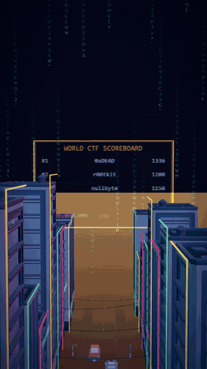

# CTF example: "Everybody Plays CTF"

A 26-second vertical short (1080×1920, 60 fps) set in a world where everyone, from bakers to schoolkids, plays capture-the-flag hacking competitions. Everything on screen is made in code: the cast with **BlockRig**, a neon city with custom shaders and particle effects in **three.js**, all rendered by **Remotion**. Nothing is downloaded for the picture.

[](../../docs/ctf.mp4)

▶ [Watch the full video with sound](../../docs/ctf.mp4)

> *In this world, everybody plays CTF… The pros threw everything. Nothing worked. So I tried the one thing nobody did. I viewed the page source.*

## Run it

Made from [`examples/template`](../template/README.md), so it works the same way: `docs/` is the source of truth.

```sh
cd examples/ctf
npm install            # also links the library from ../.. (blockrig: file:../..)
npm run setup-voice    # once per machine: Kokoro + Chatterbox voices (needs an NVIDIA GPU for Chatterbox)
npm run voice          # narration from docs/story.md + docs/audio.md, timings, music
npm run check          # every take says its line, pace, captions
npm run stills         # one still per shot + out/contact-sheet.jpg
npm run render         # out/ctf.mp4
npm run preview -- --to ../../docs   # docs/ctf.mp4 + docs/ctf-preview.gif
```

**Voice.** Chatterbox (expressive, MIT) with its voice taken from a Kokoro `am_adam` sample (Apache 2.0), pitched up
×1.35; both run offline. Lines ending in "!" are performed with panic. About 160 words a minute overall, measured
against a popular short. Every take is checked with speech recognition.

**Weather and structure.** Drizzle over the neon street, a lightning storm during the attack, clear skies when the
flag is found. Towers have ledges, rooftop tanks, AC units, antennas, fire escapes and awnings; the street has
vending machines, benches, hydrants, parked cars, cables overhead and wet, textured asphalt.

## What it shows off

| BlockRig feature | Where in the video |
|---|---|
| Body shapes (`classic`, `slender`, `tall`, `buff`, `child`) and BodyColors | the baker, the kids, the pros, the crowd |
| Classic Shirt/Pants templates drawn on canvases | hoodies, numbered team jackets, a chef jacket, school uniforms, cargo pants (`src/cast/wardrobe.ts`) |
| Attachments (`HairAttachment`, `HatAttachment`, `FaceFrontAttachment`, `BodyBackAttachment`) | layered gradient hair, caps, a chef hat, headphones, visors, glasses, backpacks (`src/cast/props.ts`) |
| Welds | laptops in hands, and rank tags floating over every head |
| IKControl | the hero's hands land on the terminal keyboard |
| AnimationTrack seeking and drawn faces | every pose and expression, computed per frame |

The world, built in this project:

- **Shaders:**
  - procedural tower windows;
  - a hex force-field dome with impact ripples, an alarm, flicker and a shatter;
  - holograms with scanlines and RGB split;
  - falling glyph rain.
- **Effects and props:**
  - attack beams, GPU particle sparks, shards and confetti;
  - searchlights, drones and a live scoreboard;
  - a view-source terminal.

For agents: [`AGENTS.md`](AGENTS.md) holds the rules. `.agents/skills/` has one skill per stage (shared with the template): viral-short, story, look, world, materials, voice, assets, camera, vfx, review, render.

## Credits and licences

- **Code, story, characters, music, shaders:** original, MIT like the rest of BlockRig.
- **Voice:** generated with Chatterbox (Resemble AI, MIT; its output carries an inaudible watermark) from a Kokoro voice (Apache 2.0).
- **Font:** Montserrat, SIL Open Font License, via `@remotion/google-fonts`.
