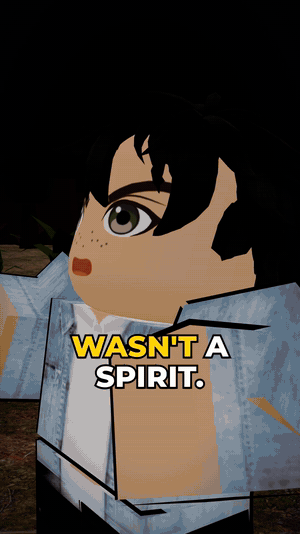

# Sawit example: "The Sawit Spirit"

A 2-minute vertical short (1080×1920, 60 fps, 40 shots) set in a kingdom where everybody plants sawit (oil palm). Any
forest left unplanted burns at night and is sawit by morning, and everyone blames the "Sawit Spirit". A kid catches
three men with torches, follows them into the palace, and finds out the kind King is behind it. In the morning the
whole town sees the proof: the King's map, a guard's badge, and the guard's confession.

[](../../docs/sawit.mp4)

▶ [Watch the full video with sound](../../docs/sawit.mp4)

Made from the [video template](../template/README.md) (`npm run new`), so the docs, kit, scripts and agent skills
are the template's.

## What's in it

- **Story, look and audio** in `docs/`: [story.md](docs/story.md) (40 shots, emotion per line),
  [visuals.md](docs/visuals.md) (cast, places, materials), [audio.md](docs/audio.md), and [feedback.md](docs/feedback.md),
  which records every change the user asked for.
- **Four places** (`src/world/World.ts`):
  - a village: Roblox Toolbox medieval houses around a cobbled square, the King's golden statue in a fountain, stalls,
    a school and a planting field, with sawit to the horizon (Kenney Nature Kit palms, instanced);
  - Grandpa's forest, the sawit fields around it, and a second forest that burns;
  - the palace (a Roblox Toolbox castle);
  - the King's secret room: the map with every forest crossed out, the ledger, a heap of gold (instanced Kenney
    coins), and oil barrels with his logo.
- **Effects** (`src/world/fire.ts`): fire, embers, smoke and water spray, all frame-pure shaders.
- **Cast** (`src/cast/characters.ts`): BlockRig characters wearing Roblox catalog items:
  - the King: a black peci, the KORPRI batik and black trousers;
  - Grandpa: a white beard and rice-farmer clothes;
  - the guards: hoods and knight outfits, carrying torches held the Roblox way (`equipTool` + `clips.toolHold`);
  - villagers and kids.
- **Voice**: one narrator in plain Node (chatterbox-js with CFG), every take checked by Whisper. Music: the
  original quirky-arp and suspense themes.

## Build it

```sh
npm install
npm run assets       # Kenney kits, Poly Haven skies and textures, poly.pizza bird (CC-BY: credit it)
npm run roblox       # Roblox catalog items and Toolbox maps: run with the browser pane signed in (assets skill)
npm run voice        # narration and music (first run downloads ~1.6 GB of voice models)
npm run check        # words, pace, captions, types
npm run stills       # out/contact-sheet.jpg
npm run render       # out/sawit.mp4
```

Roblox items appear in the video (Roblox allows that), but their files stay out of git (`assets/roblox` is ignored).
The bird model needs a credit in the video description: "Bird by Poly by Google, CC-BY 3.0 (poly.pizza)".
