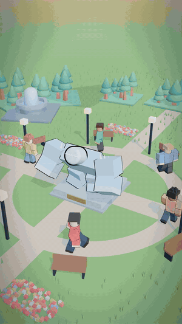

# Story example: "The Ice Statue"

A 26-second vertical short (1080×1920, 60 fps) in the "in this town…" style of viral Roblox stories, made entirely in code. The characters come from **BlockRig**, the town from CC0 kits, the animation and rendering from **Remotion** and **three.js**.

[](../../docs/story.mp4)

▶ [Watch the full video with sound](../../docs/story.mp4)

> *In this town, nobody touches the ice statue in the park. Because whoever touches it… wakes it up.*

## Run it

```sh
cd examples/story
npm install          # also links the library from ../.. (blockrig: file:../..)
npm run assets       # downloads the CC0 models and HDRI into public/cc0/
npm run voice        # narration (offline Windows SAPI voice) + synth music + timings
npm run stills       # one still per shot + out/contact-sheet.jpg, check these first
npm run render       # out/story.mp4
npm run preview      # docs/story.mp4 (small copy) + docs/story-preview.gif
npm run studio       # Remotion Studio, to scrub the timeline
```

The published video uses the Microsoft neural voice: `VOICE_ENGINE=edge npm run voice` (needs `pip install edge-tts`). It sends the narration text to Microsoft's online service and returns real per-word timings, which the captions lock to. Plain `npm run voice` stays offline (Windows SAPI) and estimates the word timings.

## How it is put together

| Stage | Where | What it does |
|---|---|---|
| Story | `story.json` | 14 shots: narration, caption chunks with highlighted words, faces, location, action, camera |
| Voice and music | `scripts/make-audio.mjs`, `scripts/music.mjs` | one WAV per line, an original synth score per mood, `public/audio/timings.json` |
| Timeline | `src/timeline.ts` | shot lengths come from the voice; captions are word-timed from it |
| Cast | `src/characters.ts` | BlockRig rigs: a kid, a giant ice statue on the `buff` body, six townsfolk, blocky hair welded by `HairAttachment` |
| Acting | `src/performance.ts`, `src/clips.ts` | per-shot staging with BlockRig's Animator; faces change with `face:` expressions |
| World | `src/World.tsx` | park, street and school from Kenney kits, instanced flowers and grass, HDRI light, snow and snow cover |
| Camera | `src/camera.ts` | one recipe per shot that follows the characters' joints |
| Picture | `src/Story.tsx`, `src/Captions.tsx` | AgX tone mapping, soft shadows, CSS vignette, Montserrat ExtraBold captions |

Everything is **frame-pure**: each frame is computed from its time alone (`poseAt` rebuilds the pose at time *t*), so Remotion can render frames in any order and in parallel.

For agents: [`AGENTS.md`](AGENTS.md) holds the rules, and `.agents/skills/` has one skill per stage (story, voice, assets, scene, render).

## Credits and licences

- Code, story, characters and music: original, MIT like the rest of BlockRig.
- City and platformer models: [Kenney](https://kenney.nl), CC0 (from the KenneyNL starter kits on GitHub).
- Sky HDRI *Evening Meadow*: [Poly Haven](https://polyhaven.com), CC0.
- Font: Montserrat, SIL Open Font License, via `@remotion/google-fonts`.

The downloaded assets are not committed (`public/cc0/` is git-ignored); `npm run assets` fetches them. Roblox catalog items can be used locally from `public/roblox/` (also git-ignored), but they are never committed or used in the published video.
